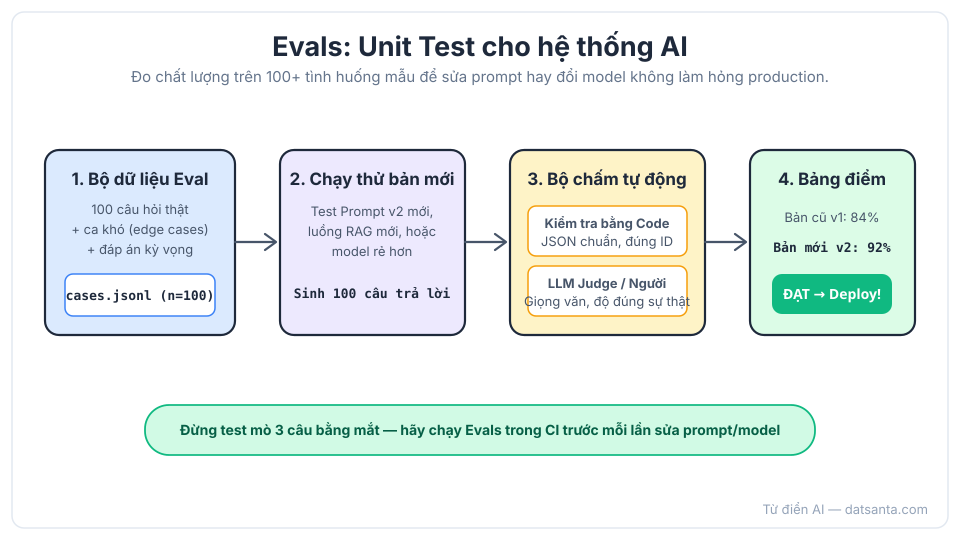

# Evals (Đánh giá tự động)

**Evals** là bộ kiểm thử tự động đo lường chất lượng tính năng AI qua hàng chục đến hàng trăm tình huống mẫu trước khi bạn đưa thay đổi về [prompt](prompt.md), model hoặc [RAG](rag.md) lên production.

## Ví dụ đời thường

Lập trình viên không bao giờ sửa code backend, test bằng mắt 1 ca rồi deploy thẳng — vậy mà nhiều nhóm sửa [prompt](prompt.md) xong chỉ thử 3 câu ("vibe check") là đẩy lên chạy thật.

Evals giải quyết triệt để: bạn chạy 100 ca lưu sẵn (kèm các ca khó) qua hệ thống mới, chấm bằng code kiểm tra cứng kết hợp [LLM-as-a-Judge](llm-as-a-judge.md), xác nhận tỷ lệ đạt tăng từ 84% lên 92% mà không làm hỏng ca cũ.

## Đừng nhầm với

- **Unit test truyền thống:** Unit test kiểm tra khớp tuyệt đối `assert x == 42`; AI evals đo tỷ lệ đạt theo xác suất và thang tiêu chí chất lượng trên câu chữ đa dạng.
- **Bảng xếp hạng model (MMLU, SWE-bench):** Leaderboard công khai đo năng lực tổng quát; *evals của bạn* kiểm tra đúng prompt, dữ liệu nội bộ và người dùng của bạn.

## Thuật ngữ liên quan

- [LLM-as-a-Judge](llm-as-a-judge.md)
- [Structured Outputs](structured-outputs.md)
- [Prompt](prompt.md)
- [RAG](rag.md)
