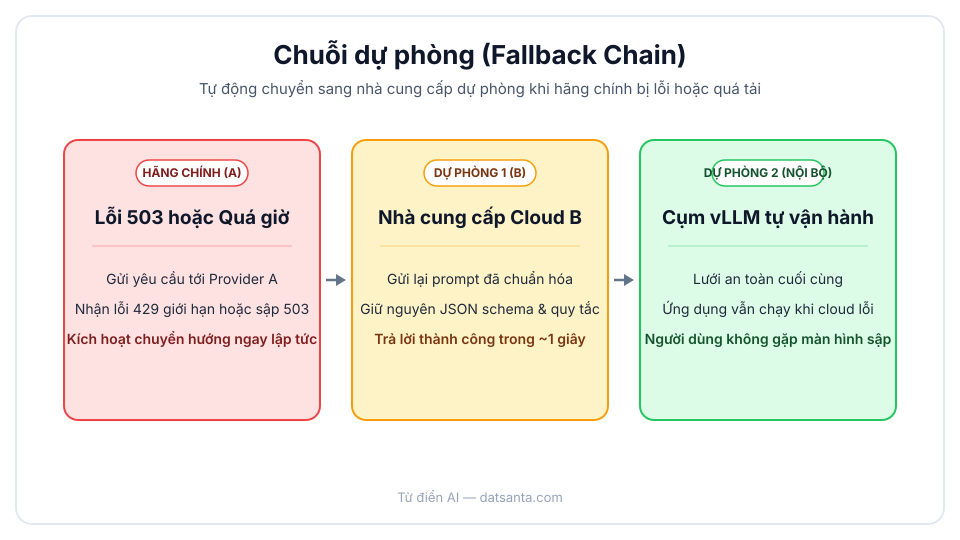

# Fallback Chain (Chuỗi dự phòng)

**Fallback chain** là danh sách các nhà cung cấp hoặc model LLM dự phòng xếp theo thứ tự ưu tiên để ứng dụng tự động thử lần lượt nếu model chính bị quá thời gian chờ, chạm trần [rate limit](rate-limiting.md) hoặc trả lỗi sập máy chủ `5xx`.

## Ví dụ thực tế

Nếu xe tải của đơn vị giao hàng chính bị hỏng vào chiều thứ Sáu, hệ thống điều vận lập tức chuyển bưu kiện sang đối tác dự phòng B để khách vẫn nhận hàng đúng hẹn. Trên hệ thống AI thực tế, một fallback chain (`Chính: Provider A -> Dự phòng 1: Provider B -> Dự phòng 2: vLLM tự host`) biến sự cố sập mạng của hãng AI thành một nhịp chuyển 1 giây vô hình thay vì làm treo ứng dụng.

## Đừng nhầm với

- **[Model Routing](model-routing.md):** Model routing chọn model phù hợp ngay từ đầu theo độ khó và chi phí; fallback chain là bậc thang cứu hộ kích hoạt khi lượt gọi chính bị lỗi.

## Thuật ngữ liên quan

- [AI Gateway](ai-gateway.md)
- [Circuit Breaker](circuit-breaker.md)
- [SLA](sla.md)
