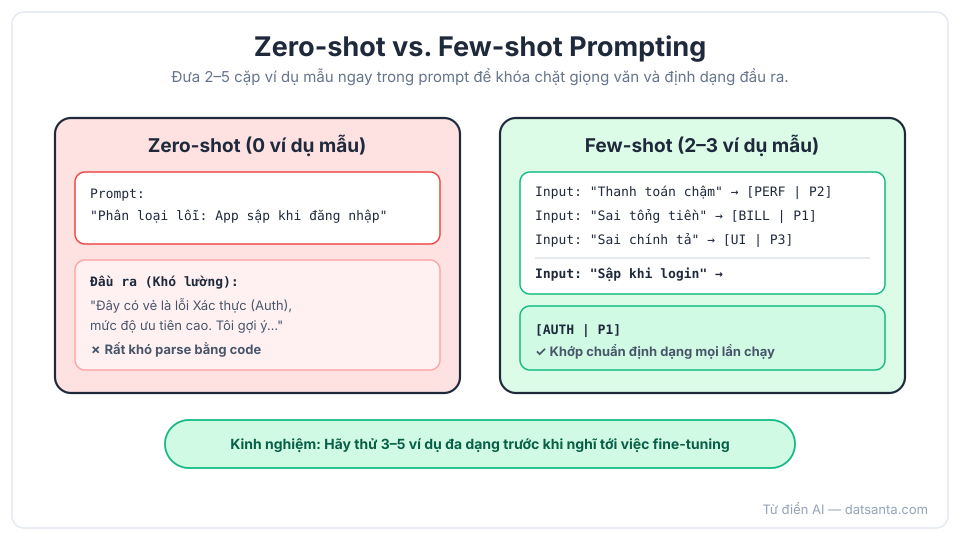

# Few-shot Prompting

**Few-shot prompting** là kỹ thuật đưa 2 đến 5 cặp ví dụ đầu vào/đầu ra cụ thể ngay bên trong [prompt](prompt.md) để [LLM](llm.md) bắt chước đúng giọng điệu, logic xử lý ca khó và định dạng bạn cần.

## Ví dụ thực tế

Nếu bạn chỉ dặn thực tập sinh *"Phân loại giúp các ticket lỗi này"* (zero-shot), mỗi lúc họ sẽ ghi một kiểu. Nhưng nếu đưa sẵn 3 thẻ mẫu — `"Thanh toán chậm" → [PERF | P2]`, `"Sai tổng tiền" → [BILL | P1]`, `"Sai chính tả" → [UI | P3]` — họ sẽ làm đúng chuẩn ngay lập tức.

Trong code thực tế, thêm 3–5 ví dụ đa dạng thường giúp độ ổn định tăng vọt chỉ sau 5 phút, chưa cần đụng tới [fine-tuning](fine-tuning.md).

## Đừng nhầm với

- **Zero-shot prompting:** Hỏi thẳng mô hình không kèm ví dụ nào; viết nhanh nhưng dễ lệch định dạng với các schema phức tạp.
- **[Fine-tuning](fine-tuning.md):** Fine-tuning cập nhật vĩnh viễn trọng số mô hình trên hàng trăm/nghìn mẫu; few-shot chỉ diễn ra ngay trong [context window](context-window.md) hiện tại.

## Thuật ngữ liên quan

- [Prompt](prompt.md)
- [Structured Outputs](structured-outputs.md)
- [Fine-tuning](fine-tuning.md)
- [Context Window](context-window.md)
