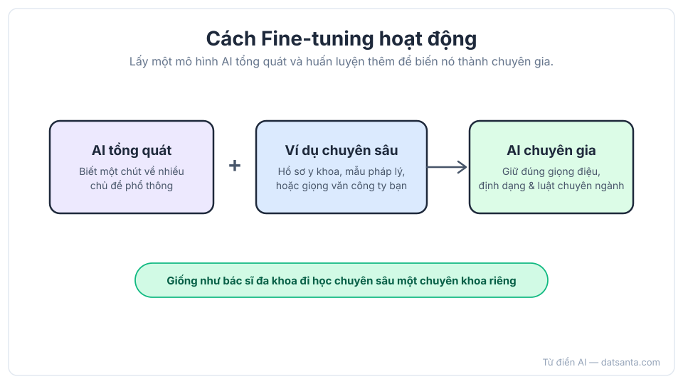

# Fine-tuning (Tinh chỉnh mô hình)

**Fine-tuning** là lấy một mô hình AI tổng quát rồi huấn luyện thêm trên bộ ví dụ riêng của bạn để biến nó thành chuyên gia. Cách này giúp AI giữ đúng giọng văn, định dạng hoặc nghiệp vụ đặc thù một cách ổn định.

## Ví dụ thực tế

Hãy nghĩ tới một bác sĩ đa khoa mới tốt nghiệp bắt đầu học chuyên khoa tim mạch. Họ đã nắm vững kiến thức y khoa nền tảng, nên bạn không cần dạy lại từ đầu — chỉ cần cho thực hành chuyên sâu vào một lĩnh vực cụ thể.

Tương tự, bạn lấy một [LLM](llm.md) có sẵn và cho nó học hàng trăm mẫu trả lời chăm sóc khách hàng hoặc tóm tắt hồ sơ của riêng công ty bạn để nó nói đúng "chất" của bạn.

## Đừng nhầm với

- **[RAG](rag.md):** Dùng RAG khi bạn muốn AI cập nhật kiến thức mới hoặc tra cứu tài liệu riêng; dùng fine-tuning khi bạn muốn AI học một giọng điệu, phong cách hay cấu trúc trả lời cố định.
- **[Prompt](prompt.md):** Prompt chỉ hướng dẫn trong một cuộc chat mà không làm đổi mô hình; fine-tuning thay đổi chính mô hình đó cho mọi lần dùng sau.

## Thuật ngữ liên quan

- [Machine learning](machine-learning.md)
- [RAG](rag.md)
- [LLM](llm.md)
