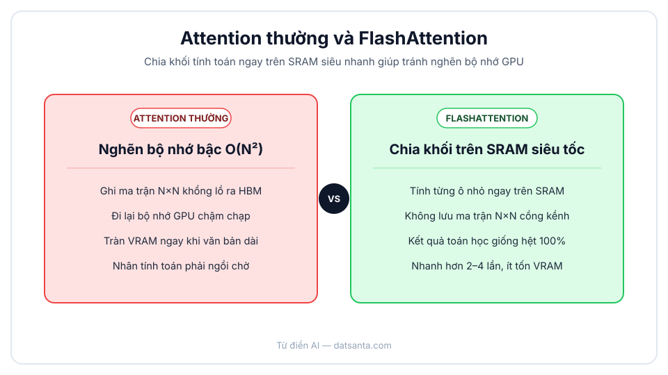

# FlashAttention

**FlashAttention** là thuật toán tính toán attention chính xác bằng cách chia nhỏ dữ liệu thành từng khối vừa khít bộ nhớ siêu nhanh SRAM trên chip GPU, tránh đọc ghi lặp đi lặp lại các ma trận khổng lồ ra bộ nhớ GPU chậm hơn.

## Ví dụ thực tế

Giả sử đầu bếp cần trộn 10.000 nguyên liệu. Nếu cứ mỗi thìa gia vị lại chạy bộ sang nhà kho bên kia đường lấy một lần thì mất hết 90% thời gian trong ngày. Đặt sẵn một tô sơ chế nhỏ ngay trên thớt và trộn xong gọn từng mẻ sẽ nhanh hơn gấp bội mà món ăn vẫn y hệt. FlashAttention giảm mức tiêu tốn bộ nhớ từ bậc hai xuống bậc tuyến tính, mở đường cho cửa sổ ngữ cảnh siêu dài mà không hề giảm độ chính xác.

## Đừng nhầm với

- **[Quantization](quantization.md):** Quantization nén trọng số model bằng cách giảm độ chính xác số học (có đánh đổi nhỏ); FlashAttention tính attention *chính xác tuyệt đối* nhanh hơn thuần túy nhờ tối ưu luồng đọc ghi bộ nhớ GPU.

## Thuật ngữ liên quan

- [Attention Mechanism](attention-mechanism.md)
- [VRAM](vram.md)
- [Context Window](context-window.md)
