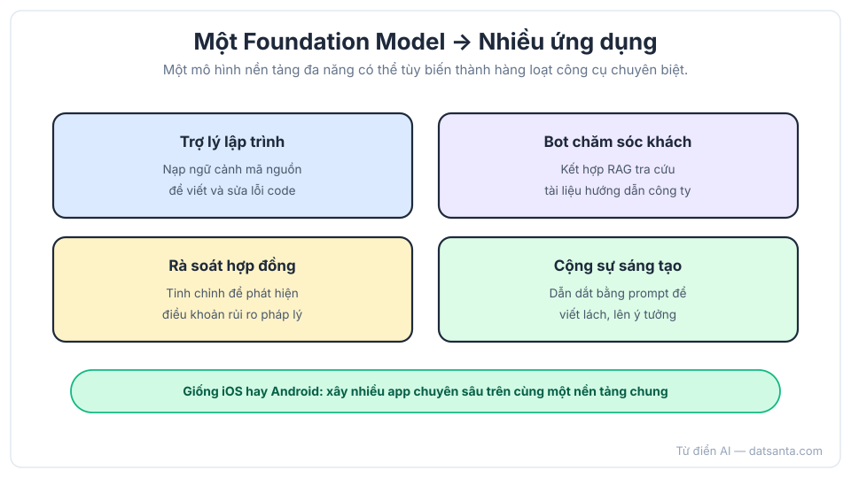

# Foundation Model (Mô hình nền tảng)

**Foundation model** là mô hình AI cỡ lớn, đa năng được huấn luyện trên kho dữ liệu khổng lồ để xử lý nhiều tác vụ khác nhau — và làm nền tảng xây dựng nên hàng loạt ứng dụng chuyên biệt.

## Ví dụ thực tế

Hãy nghĩ tới hệ điều hành điện thoại như iOS hay Android. Các nhà phát triển không cần tự chế tạo một chiếc điện thoại mới chỉ để làm app thời tiết hay app ngân hàng — họ xây thẳng trên một nền tảng chung có sẵn.

Tương tự, từ một foundation model (như GPT, Claude hay Gemini), bạn có thể tùy biến bằng [prompt](prompt.md), [RAG](rag.md) hoặc [fine-tuning](fine-tuning.md) thành trợ lý lập trình, công cụ rà soát hợp đồng hay bot chăm sóc khách hàng.

## Đừng nhầm với

- **[LLM](llm.md):** Phần lớn foundation model hiện nay là LLM, nhưng foundation model còn có thể là [multimodal AI](multimodal-ai.md) xử lý cả ảnh, video, âm thanh hay robot chứ không riêng văn bản.
- **AI chuyên biệt đời cũ:** Các mô hình cũ chỉ làm được đúng *một* việc (như lọc thư rác); foundation model làm được hàng trăm việc ngay khi vừa ra mắt.

## Thuật ngữ liên quan

- [LLM](llm.md)
- [Multimodal AI](multimodal-ai.md)
- [Fine-tuning](fine-tuning.md)
- [Open-Source AI](open-source-ai.md)
