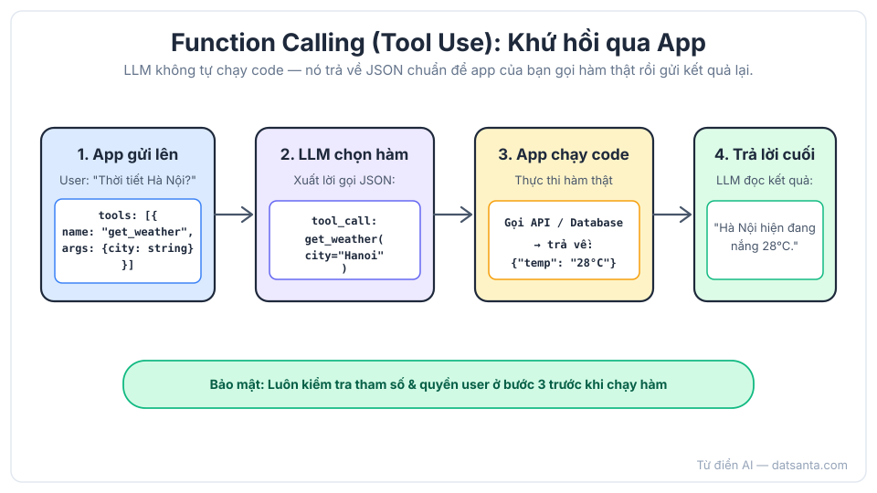

# Function Calling (Tool Use)

**Function calling** cho phép [LLM](llm.md) xuất ra dữ liệu JSON chuẩn chỉ định tên hàm và tham số cần gọi để code ứng dụng của bạn thực thi hành động thật (truy vấn DB, gọi API) rồi trả kết quả lại cho mô hình.

## Ví dụ đời thường

Hãy hình dung một đầu bếp (LLM) không được phép tự bước vào kho lạnh. Bạn đưa cho họ danh sách các việc nhân viên phụ bếp làm được (`get_weather`, `query_order`). Khi khách hỏi *"Thời tiết Hà Nội hôm nay?"*, đầu bếp đưa lại tờ giấy ghi chuẩn: `get_weather(city="Hanoi")`.

Backend của bạn chạy lệnh gọi API thời tiết thật, gửi `{"temp": "28°C"}` ngược lại cho LLM, rồi LLM mới viết câu trả lời tự nhiên cho khách.

## Đừng nhầm với

- **LLM tự chạy code trực tiếp:** Mô hình *không bao giờ* chạm thẳng vào database của bạn; nó chỉ sinh ra yêu cầu JSON để ứng dụng của bạn kiểm tra quyền và thực thi an toàn.
- **[MCP](mcp.md):** Function calling là tính năng ở cấp API của mô hình; MCP là chuẩn giao tiếp chung giúp các ứng dụng chia sẻ và kết nối công cụ đồng nhất.

## Thuật ngữ liên quan

- [Structured Outputs](structured-outputs.md)
- [MCP](mcp.md)
- [ReAct Pattern](react-pattern.md)
- [AI Agent](ai-agent.md)
