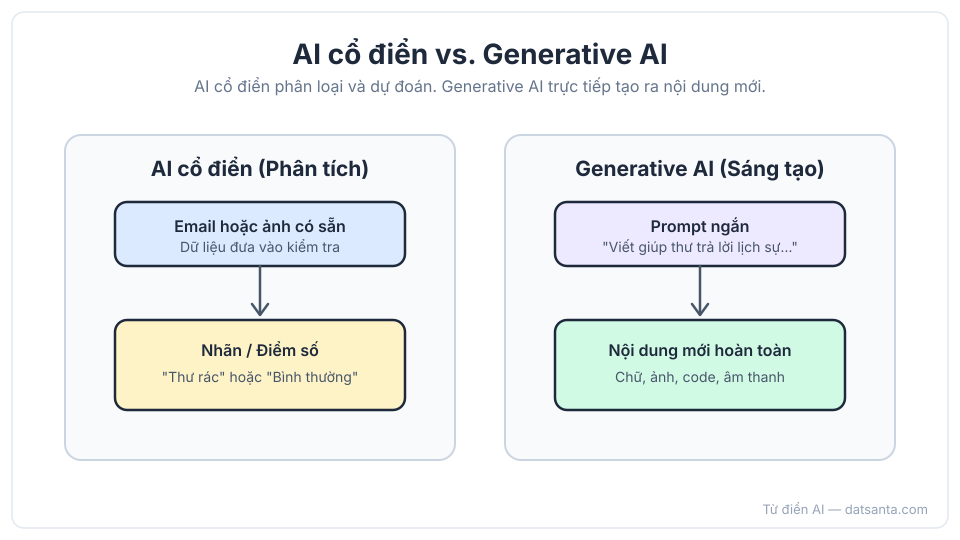

# Generative AI (AI tạo sinh)

**Generative AI** là dạng AI có khả năng tạo ra nội dung mới hoàn toàn — như văn bản, hình ảnh, code, âm thanh hoặc video — dựa trên một câu lệnh ngắn từ bạn. Nếu AI thế hệ cũ chủ yếu phân loại dữ liệu có sẵn, thì generative AI trực tiếp sáng tạo ra sản phẩm mới.

## Ví dụ thực tế

Hãy so sánh nhà phê bình ẩm thực và đầu bếp. AI cổ điển giống nhà phê bình: nếm thử món ăn rồi gắn nhãn (*"hơi mặn"* hoặc *"5 sao"*). Còn generative AI giống đầu bếp: bạn yêu cầu *"làm giúp bữa tối chay nhanh gọn với cà chua"*, nó tự nấu ra một món mới từ đầu.

Những công cụ quen thuộc như ChatGPT, Midjourney hay Suno đều là generative AI.

## Đừng nhầm với

- **[AI](ai.md):** AI còn bao gồm các hệ thống cũ chuyên lọc thư rác, gợi ý phim hoặc phát hiện gian lận thẻ tín dụng mà không tạo ra nội dung mới.
- **[LLM](llm.md):** Một loại generative AI chuyên xử lý văn bản; generative AI còn gồm cả công cụ tạo ảnh, nhạc và video.

## Thuật ngữ liên quan

- [AI](ai.md)
- [LLM](llm.md)
- [Prompt](prompt.md)
- [Hallucination](hallucination.md)
