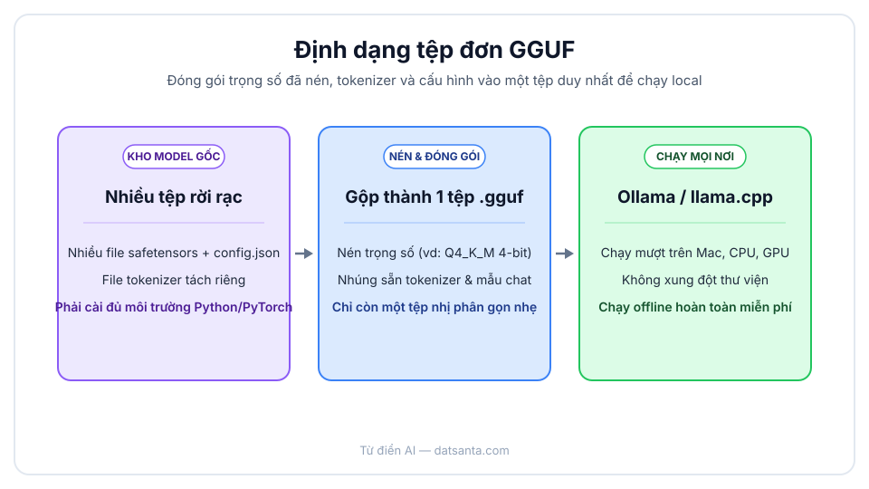

# GGUF Format (Định dạng tệp GGUF)

**GGUF** là định dạng tệp nhị phân đơn nhất tạo ra cho `llama.cpp`, đóng gói chung trọng số model mở đã lượng tử hóa, bộ tokenizer và siêu dữ liệu kiến trúc để chạy gọn gàng trên laptop, CPU và chip Apple Silicon.

## Ví dụ thực tế

Tải một model PyTorch thô đôi khi giống như mua đồ nội thất rời với 12 thùng carton và thiếu ốc vít, xung đột thư viện Python. Một tệp `.gguf` là gói hoàn chỉnh sẵn sàng chạy ngay (`qwen-7b-Q4_K_M.gguf`)—chỉ cần tải đúng một file, mở bằng [Ollama](ollama.md) hoặc `llama.cpp` là chạy offline ngon lành mà không lo cài đặt rắc rối.

## Đừng nhầm với

- **[Quantization](quantization.md):** Quantization là kỹ thuật nén trọng số (như 4-bit `Q4_K_M`); GGUF là định dạng vỏ tệp di động dùng để lưu trữ và phân phối các trọng số đã nén đó.

## Thuật ngữ liên quan

- [Quantization](quantization.md)
- [Ollama](ollama.md)
- [Inference](inference.md)
