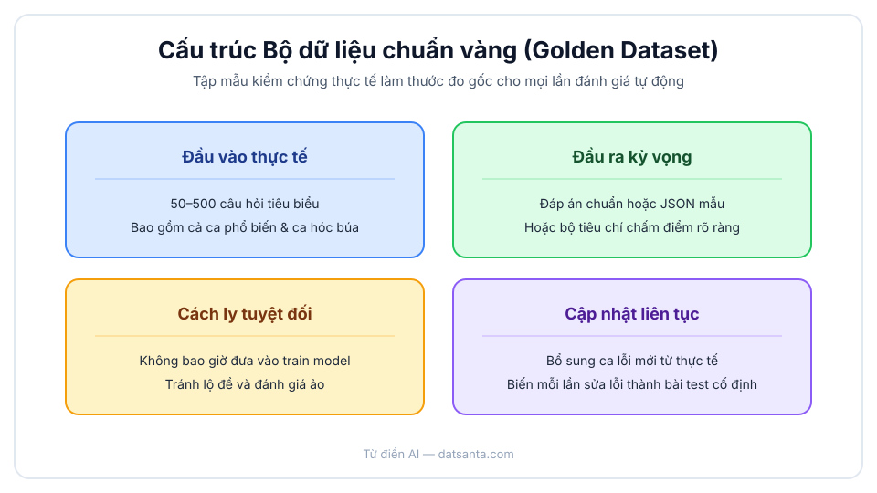

# Golden Dataset (Bộ dữ liệu chuẩn vàng)

**Golden dataset** là bộ tập hợp gồm các câu hỏi mẫu tiêu biểu và đáp án chuẩn (hoặc tiêu chí chấm) đã được con người kiểm duyệt, dùng làm thước đo gốc mỗi khi bạn chỉnh sửa prompt, đổi model hoặc tinh chỉnh [RAG](rag.md).

## Ví dụ thực tế

Trước khi phát hành bản cập nhật phần mềm cho máy pha cà phê, nhà máy luôn chạy lại đúng 50 bài kiểm tra chuẩn về nhiệt độ, áp suất và lượng chiết xuất—chứ không uống thử một ly ngẫu nhiên rồi đoán. Bộ golden dataset (thường gồm 50–500 ca thực tế hóc búa) giúp kỹ sư chạy [evals](evals.md) tự động chỉ trong vài phút để chứng minh bản sửa prompt thực sự tốt lên.

## Đừng nhầm với

- **[Training Data](training-data.md):** Training data dùng để dạy model cách trả lời lúc huấn luyện; golden dataset phải tách biệt hoàn toàn như một đề thi kín để đo độ chính xác công tâm.

## Thuật ngữ liên quan

- [Evals (Evaluations)](evals.md)
- [Regression Testing](regression-testing.md)
- [LLM-as-a-Judge](llm-as-a-judge.md)
