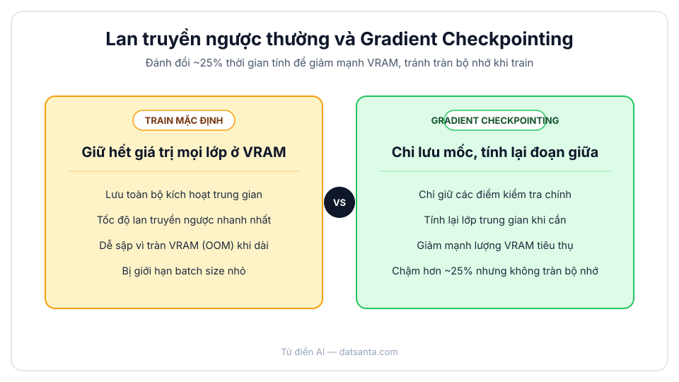

# Gradient Checkpointing (Lưu điểm kiểm tra Gradient)

**Gradient checkpointing** là kỹ thuật tối ưu bộ nhớ khi huấn luyện bằng cách bỏ bớt phần lớn giá trị kích hoạt trung gian ở lượt tính xuôi (forward pass) và tính lại nhanh khi cần ở lượt lan truyền ngược (backward pass).

## Ví dụ thực tế

Khi giải một bài toán dài 50 bước trên chiếc bảng trắng nhỏ xíu, bạn không đủ chỗ giữ lại cả 50 dòng nháp cùng lúc. Thay vào đó, bạn chỉ ghi giữ các mốc kết quả sau mỗi 10 bước, xóa phần giữa đi, rồi nhẩm tính lại đoạn ngắn đó khi kiểm tra ngược. Kỹ thuật này đánh đổi thêm khoảng 20–30% thời gian tính toán để nhét vừa batch size lớn hơn hoặc chuỗi dài hơn vào [VRAM](vram.md).

## Đừng nhầm với

- **[KV Cache](kv-cache.md):** KV cache tăng tốc lúc *suy luận (inference)* bằng cách giữ lại token cũ trong bộ nhớ; gradient checkpointing tiết kiệm bộ nhớ lúc *huấn luyện (training)* bằng cách tính lại thay vì lưu giữ.

## Thuật ngữ liên quan

- [VRAM](vram.md)
- [QLoRA](qlora.md)
- [Fine-tuning](fine-tuning.md)
