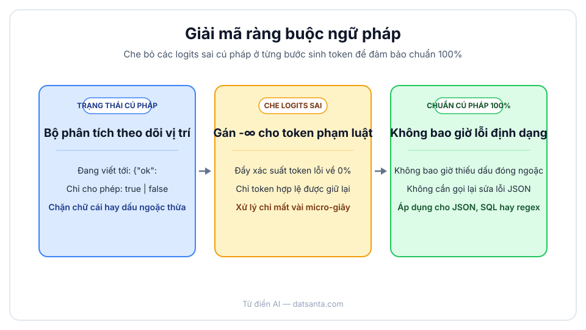

# Grammar-Constrained Decoding (Giải mã ràng buộc ngữ pháp)

**Grammar-constrained decoding** áp đặt một quy tắc cú pháp chặt chẽ (như [JSON Schema](json-schema.md) hoặc regex) ở từng bước sinh token bằng cách che bỏ các [logits](logits.md) không hợp lệ trước khi lấy mẫu, đảm bảo đầu ra luôn đúng cú pháp 100%.

## Ví dụ thực tế

Hãy hình dung bàn phím cây ATM tự động vô hiệu hóa toàn bộ phím chữ cái khi yêu cầu nhập mã PIN 4 chữ số—bạn có cố bấm nhầm cũng không thể gõ ra chữ. Lúc giải mã, một bộ máy trạng thái theo dõi vị trí chuỗi JSON hiện tại (`{"status": "`), chặn mọi token làm vỡ cú pháp JSON và chỉ cho phép đi qua đúng các giá trị enum hợp lệ.

## Đừng nhầm với

- **[Prompt Engineering](prompt-engineering.md):** Prompting chỉ *nhờ* model trả về JSON hợp lệ (và nó vẫn có thể lỡ tay viết sai); grammar-constrained decoding *chặn đứng về mặt toán học* mọi token sai cú pháp ngay lúc sinh chữ.

## Thuật ngữ liên quan

- [JSON Schema](json-schema.md)
- [Structured Outputs](structured-outputs.md)
- [Logits](logits.md)
