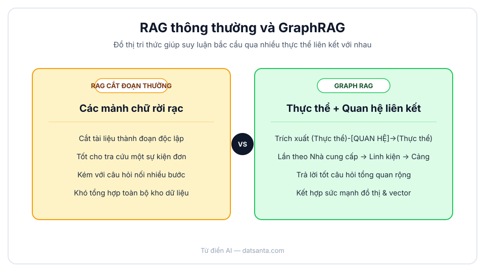

# GraphRAG (RAG kết hợp Đồ thị tri thức)

**GraphRAG** kết hợp đồ thị tri thức (các thực thể và mối quan hệ rõ ràng) với tìm kiếm vector, giúp LLM trả lời được những câu hỏi suy luận nhiều bước hoặc tổng hợp bức tranh toàn cục trên cả kho dữ liệu lớn.

## Ví dụ thực tế

[RAG](rag.md) cắt đoạn thông thường rất lúng túng khi bị hỏi `"Nhà cung cấp nào bán linh kiện nằm trong các sản phẩm đang bị kẹt ở Cảng B?"`, vì không có đoạn văn đơn lẻ nào chứa đủ cả ba mắt xích đó. GraphRAG trích xuất các liên kết (`Nhà cung cấp -> bán -> Linh kiện -> dùng cho -> Sản phẩm -> đi qua -> Cảng B`) vào đồ thị, lần theo các cạnh nối để đưa đầy đủ ngữ cảnh quan hệ cho LLM.

## Đừng nhầm với

- **[Vector Database](vector-database.md):** Vector database tìm các đoạn văn bản giống nhau về ngữ nghĩa; GraphRAG lưu tường minh các mắt xích thực thể–quan hệ để suy luận bắc cầu nhiều bước.

## Thuật ngữ liên quan

- [RAG](rag.md)
- [Agentic RAG](agentic-rag.md)
- [Hybrid Search](hybrid-search.md)
