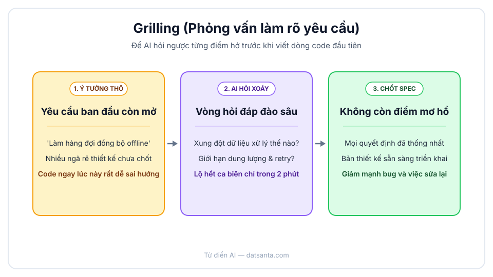

# Grilling (Phỏng vấn làm rõ yêu cầu)

**Grilling** là kỹ thuật yêu cầu AI agent chủ động hỏi ngược lại bạn những câu hỏi sắc bén về trường hợp biên, đánh đổi kỹ thuật và quyết định thiết kế *trước khi* bắt tay viết code, giúp lộ sớm mọi điểm mơ hồ.

## Ví dụ thực tế

Thợ may giỏi không bao giờ cầm kéo cắt vải đắt tiền chỉ sau câu `"may giúp tôi bộ vest"`—họ sẽ hỏi kỹ dáng ôm hay rộng, kiểu túi, lớp lót và dịp mặc trước. Vì LLM có thói quen tự đoán bừa khi yêu cầu còn lờ mờ, bảo agent `"hãy hỏi xoáy mọi điểm chưa rõ trước khi viết spec"` sẽ kéo hết giả định ẩn ra ánh sáng lúc sửa chỉ mất 10 giây thay vì sửa 10 file code.

## Đừng nhầm với

- **[Spec](spec.md):** Grilling là *quá trình hỏi đáp tương tác* để chốt các quyết định còn thiếu; spec là *tài liệu hoàn chỉnh* được viết ra sau khi đã trả lời hết các câu hỏi đó.

## Thuật ngữ liên quan

- [Spec](spec.md)
- [Sycophancy](sycophancy.md)
- [Planning Pattern](planning-pattern.md)
