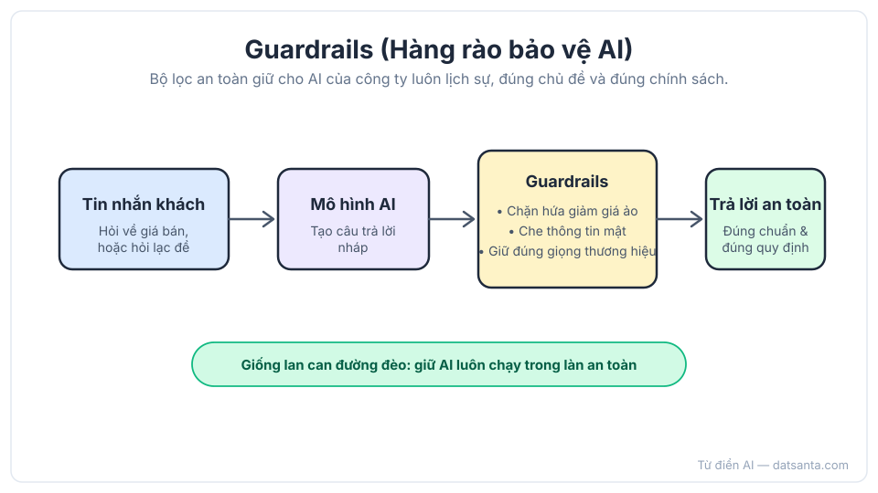

# Guardrails (Hàng rào bảo vệ AI)

**Guardrails** là các quy tắc an toàn và bộ lọc tự động đặt quanh hệ thống AI của doanh nghiệp để ngăn AI nói sai lệch thương hiệu, thô lỗ, bịa thông tin hoặc gây rủi ro cho khách hàng.

## Ví dụ thực tế

Hãy nghĩ đến lan can thép dọc đường đèo. Lan can không lái xe thay bạn, nhưng nếu xe lỡ chệch hướng về phía vực, nó sẽ giữ xe an toàn trên mặt đường.

Với chatbot bán hàng của công ty, guardrails giúp chặn đứng các câu trả lời kiểu tự hứa giảm giá 80%, làm lộ số điện thoại khách hàng hoặc tranh cãi với người mua — chặn lỗi ngay trước khi chữ kịp hiện lên màn hình.

## Đừng nhầm với

- **[Prompt](prompt.md):** Prompt chỉ nhắc nhở AI cư xử khéo léo, nhưng AI vẫn có thể quên hoặc bị lừa bỏ qua; guardrails là lớp kiểm tra bắt buộc chạy bên ngoài câu trả lời của mô hình.
- **[AI governance](ai-governance.md):** Governance là quy định quản lý của công ty; guardrails là lớp chốt chặn kỹ thuật chạy bằng phần mềm.

## Thuật ngữ liên quan

- [Prompt Injection](prompt-injection.md)
- [Human-in-the-Loop](human-in-the-loop.md)
- [Hallucination](hallucination.md)
