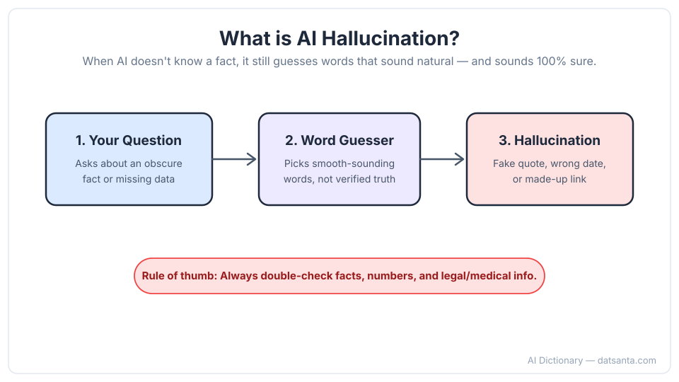

# Hallucination (Ảo giác AI)

**Hallucination** là hiện tượng AI tự bịa ra thông tin sai sự thật — như trích dẫn giả, sai ngày tháng hoặc đường link không tồn tại — nhưng vẫn trả lời với giọng điệu cực kỳ tự tin.

## Ví dụ đời thường

Hãy tưởng tượng bạn hỏi đường một người mới quen rất khéo ăn nói ở thành phố họ không rành. Thay vì thừa nhận *"Mình không chắc lắm"*, họ tự nghĩ ra một tên đường nghe rất hợp lý rồi chỉ tay đầy tự tin.

Vì [LLM](llm.md) được thiết kế để đoán những từ ngữ nghe tự nhiên nhất chứ không phải để kiểm chứng sự thật, đôi lúc nó sẽ lấp khoảng trống kiến thức bằng những chi tiết hư cấu nghe rất thuyết phục.

## Đừng nhầm với

- **Lỗi phần mềm (Bug):** Ứng dụng bị văng hoặc nút bấm không chạy là lỗi lập trình; hallucination là hệ quả tự nhiên của cách mô hình ngôn ngữ đoán chữ.
- **Nói dối:** AI không có ý định lừa gạt — nó không biết đúng hay sai, chỉ biết những từ nào thường đi cùng nhau.

## Thuật ngữ liên quan

- [LLM](llm.md)
- [RAG](rag.md)
- [Generative AI](generative-ai.md)
