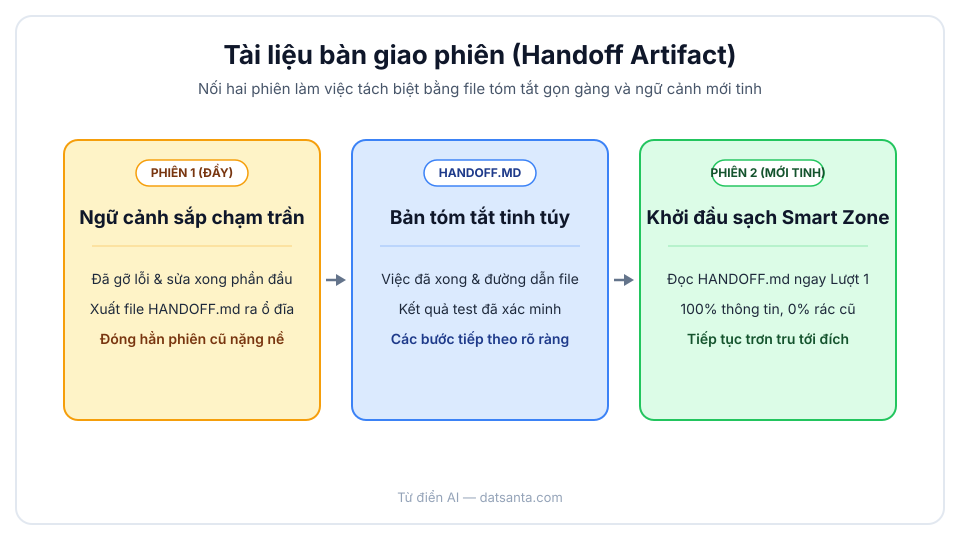

# Handoff Artifact (Tài liệu bàn giao phiên)

**Handoff artifact** là một file Markdown tóm tắt ngắn gọn ghi ra ổ đĩa cuối mỗi phiên lập trình dài—lưu lại việc đã xong, đường dẫn file quan trọng, kết quả đã kiểm chứng và bước tiếp theo—để phiên mới tiếp nhận mượt mà với [context window](context-window.md) sạch tinh.

## Ví dụ thực tế

Khi điều dưỡng bệnh viện hết ca trực 12 tiếng, họ không ném 400 tờ giấy in chỉ số thô cho người ca sau; họ bàn giao một tờ ghi chú một trang rõ ràng gồm chỉ số hiện tại, thuốc đã dùng và việc cần kiểm tra lúc 8 giờ sáng. Viết handoff artifact trước khi mở phiên chat mới giúp phiên sau giữ 100% thông tin tinh túy ngay trong [smart zone](smart-zone.md) mà không dính rác cũ.

## Đừng nhầm với

- **[Compaction](compaction.md):** Compaction tóm tắt lịch sử ngay bên trong *phiên hiện tại*; handoff artifact cho phép đóng hẳn phiên cũ nặng nề và khởi động lại sạch sẽ từ một file gọn gàng.

## Thuật ngữ liên quan

- [Compaction](compaction.md)
- [Smart Zone](smart-zone.md)
- [Checkpointing](checkpointing.md)
