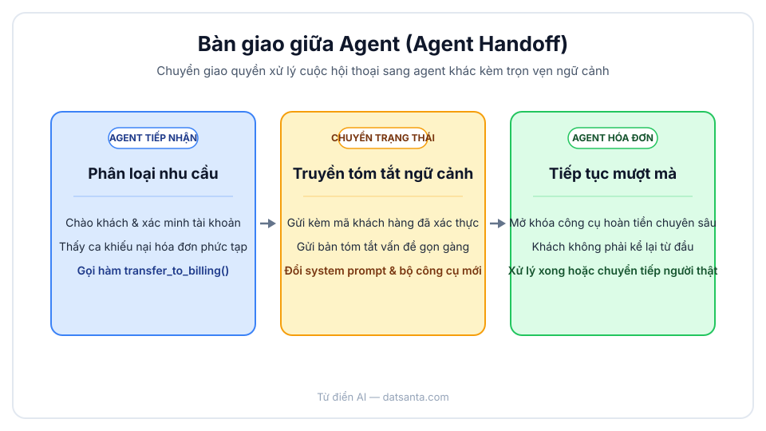

# Agent Handoff (Bàn giao giữa các Agent)

**Agent handoff** là việc chuyển giao quyền điều khiển một cuộc hội thoại hoặc tác vụ đang chạy từ agent chuyên trách này sang agent khác—hoặc sang con người—kèm theo trạng thái và bản tóm tắt ngữ cảnh liên quan.

## Ví dụ thực tế

Khi bạn gọi tổng đài ngân hàng báo mất thẻ, lễ tân xác minh danh tính xong sẽ chuyển máy sang chuyên viên xử lý gian lận kèm toàn bộ hồ sơ đã xác thực trên màn hình để bạn không phải kể lại từ đầu. Trong code, agent phân loại trả về một lời gọi hàm bàn giao (`transfer_to_billing_agent`) để hoán đổi system prompt và bộ công cụ đang hoạt động một cách trơn tru.

## Đừng nhầm với

- **[Function Calling](function-calling.md):** Một tool call thông thường chỉ lấy dữ liệu hoặc chạy tác vụ rồi trả quyền lại cho *chính agent đó*; handoff chuyển hẳn quyền làm chủ cuộc hội thoại sang *agent khác*.

## Thuật ngữ liên quan

- [Multi-Agent System](multi-agent-system.md)
- [Escalation Path](escalation-path.md)
- [State Machine](state-machine.md)
