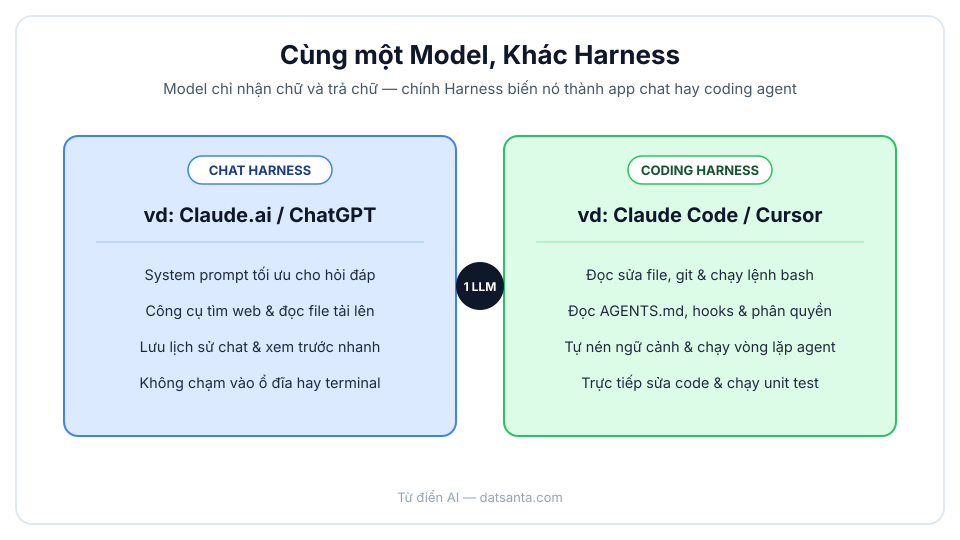

# Harness (Lớp khung vận hành Agent)

**Harness** là toàn bộ lớp phần mềm bao quanh một LLM—gồm system prompt, bộ công cụ (tools), quản lý cửa sổ ngữ cảnh, cơ chế xin quyền, hooks và vòng lặp thực thi—giúp biến một model thuần nhận-chữ/trả-chữ thành sản phẩm AI hay coding agent thực thụ.

## Ví dụ thực tế

Hãy hình dung LLM như khối động cơ mạnh đặt trên giá đỡ: tự nó chỉ biết quay trục (nhận văn bản vào, sinh văn bản ra). Harness chính là khung xe, vô-lăng, phanh, bình xăng và bảng điều khiển lắp quanh động cơ đó. Đặt cùng một model vào chat harness như Claude.ai thì bạn chỉ trò chuyện hỏi đáp; nhưng đặt vào coding harness như Claude Code, Cursor hay Codex CLI thì nó biết đọc sửa file, chạy lệnh terminal, hỏi xác nhận trước thao tác rủi ro và tự nén ngữ cảnh. Khi hai công cụ dùng chung một model mà hành xử khác hẳn nhau, nguyên nhân thường nằm ở harness.

## Đừng nhầm với

- **[LLM](llm.md):** LLM là mạng nơ-ron dự đoán token bên trong; harness là phần mềm bao ngoài chạy vòng lặp agent, thực thi tool call và đọc các file cấu hình như `AGENTS.md`.
- **[Orchestration](orchestration.md):** Orchestration điều phối nhiều model, nhiều agent hoặc nhiều bước pipeline với nhau; harness là lớp vỏ trực tiếp trang bị công cụ, bộ nhớ phiên và phân quyền cho model hành động.

## Thuật ngữ liên quan

- [AI Agent](ai-agent.md)
- [Function Calling](function-calling.md)
- [System Prompt](system-prompt.md)
