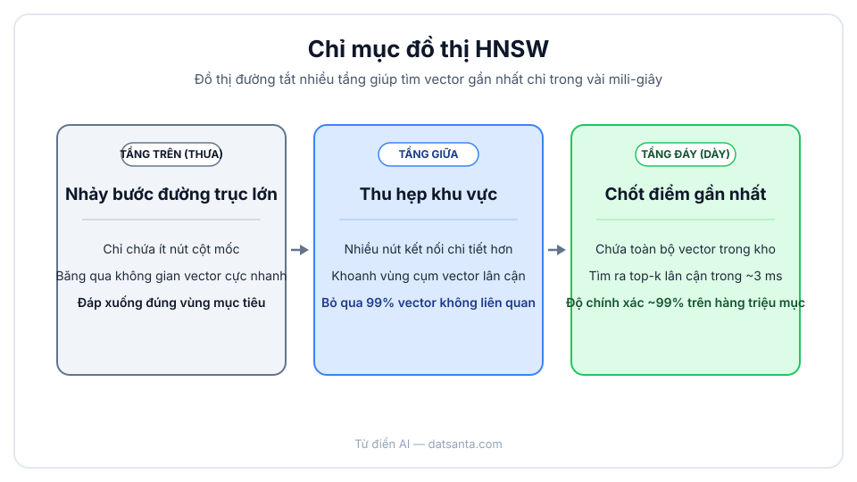

# HNSW (Chỉ mục đồ thị nhiều tầng)

**HNSW (Hierarchical Navigable Small World)** là cấu trúc chỉ mục đồ thị phổ biến nhất trong vector database, giúp tìm các vector gần nhất chỉ trong vài mili-giây mà không cần so sánh với từng vector một trong kho dữ liệu.

## Ví dụ thực tế

Hãy hình dung chuyến bay xuyên quốc gia: trước tiên bạn đi đường trục cao tốc nối các thành phố lớn (tầng thưa trên cùng), rồi rẽ sang đường tỉnh vào đúng quận (tầng giữa), cuối cùng đi đường hẻm tới tận số nhà (tầng dày dưới cùng). HNSW dựng mạng lưới đường tắt nhiều tầng y hệt cho vector, đạt độ chính xác ~99% trên hàng triệu embeddings chỉ trong tích tắc.

## Đừng nhầm với

- **[Cosine Similarity](cosine-similarity.md):** Cosine similarity là công thức toán đo khoảng cách giữa hai vector; HNSW là cấu trúc chỉ mục đồ thị quyết định *những vector nào* cần đem ra so sánh.

## Thuật ngữ liên quan

- [Vector Database](vector-database.md)
- [Embeddings](embeddings.md)
- [Cosine Similarity](cosine-similarity.md)
