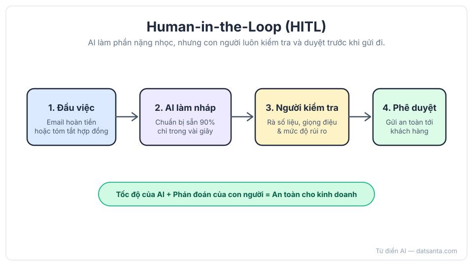

# Human-in-the-Loop (Con người trong vòng kiểm soát)

**Human-in-the-loop (HITL)** là nguyên tắc luôn giữ một con người ở khâu kiểm tra, chỉnh sửa hoặc phê duyệt kết quả của AI trước khi gửi tới khách hàng hay thực hiện hành động thật. AI làm nháp; con người chốt.

## Ví dụ thực tế

Hãy nghĩ đến chế độ lái tự động trên máy bay. Hệ thống tự động giữ máy bay bay ổn định suốt nhiều giờ, nhưng phi công vẫn ngồi trong buồng lái để theo dõi thông số, xử lý thời tiết xấu và quyết định lúc hạ cánh.

Trong doanh nghiệp, AI có thể soạn sẵn 50 email hoàn tiền hoặc tóm tắt hợp đồng trong vài giây, còn nhân viên chỉ mất 10 giây kiểm tra lại số liệu rồi bấm gửi. Bạn vừa có tốc độ của AI, vừa không lo rủi ro sai sót.

## Đừng nhầm với

- **Tự động hóa hoàn toàn:** Bỏ hẳn con người để AI tự quyết mọi thứ — rất rủi ro khi sai sót liên quan đến tiền bạc, pháp lý hoặc uy tín với khách hàng.
- **Làm thủ công từ đầu:** Với human-in-the-loop, AI làm sẵn 80–90% bản nháp để nhân sự chỉ tập trung vào khâu đánh giá và ra quyết định.

## Thuật ngữ liên quan

- [Hallucination](hallucination.md)
- [Guardrails](guardrails.md)
- [AI Governance](ai-governance.md)
