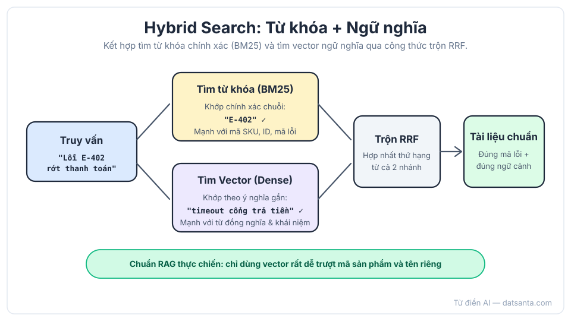

# Hybrid Search (Tìm kiếm lai)

**Hybrid search** chạy song song cả tìm kiếm từ khóa chính xác (`BM25`) và tìm kiếm ngữ nghĩa qua [vector database](vector-database.md), sau đó trộn hai danh sách kết quả (thường bằng thuật toán `RRF`) để không bỏ sót cả mã định danh lẫn từ đồng nghĩa.

## Ví dụ thực tế

Giả sử người dùng tra tài liệu kỹ thuật với cụm `"Lỗi E-402 rớt thanh toán"`. Tìm kiếm vector hiểu `"rớt thanh toán"` gần nghĩa với `"timeout cổng trả tiền"`, nhưng có thể xếp sai trang vì `"E-402"` là mã tự đặt. Ngược lại, tìm kiếm từ khóa (`BM25`) bắt dính `"E-402"` ngay lập tức.

Trộn hai bảng xếp hạng bằng `RRF` sẽ đẩy tài liệu chứa cả `"E-402"` lẫn hướng dẫn xử lý timeout lên vị trí `#1`.

## Đừng nhầm với

- **Tìm vector thuần túy:** Hệ thống chỉ dùng vector rất hay trượt mã SKU, ID người dùng, từ viết tắt nội bộ và tên hàm chính xác.
- **[Reranking](reranking.md):** Hybrid search giúp *lấy nhanh* tập ứng viên từ hai chỉ mục; reranking chạy ngay bước kế tiếp để chấm điểm sâu lại nhóm đầu.

## Thuật ngữ liên quan

- [Vector Database](vector-database.md)
- [Reranking](reranking.md)
- [RAG](rag.md)
- [Embeddings](embeddings.md)
