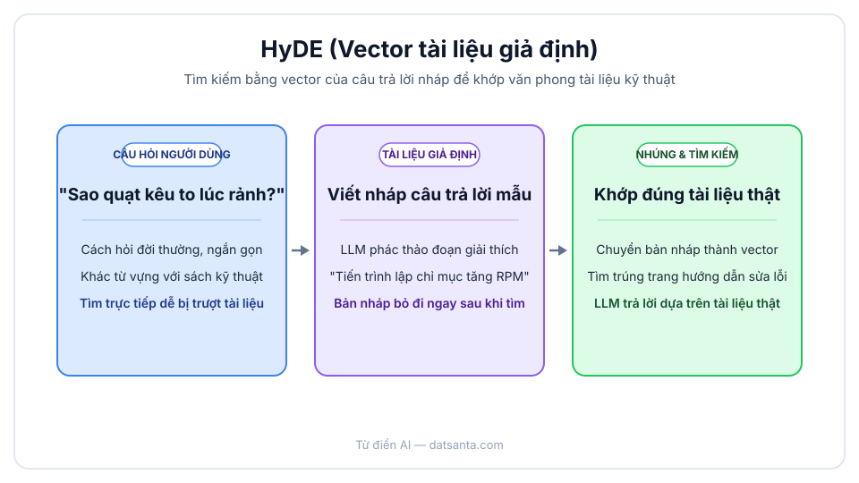

# HyDE (Vector tài liệu giả định)

**HyDE (Hypothetical Document Embeddings)** cải thiện tìm kiếm vector bằng cách nhờ LLM viết nháp một câu trả lời lý tưởng giả định trước, rồi dùng vector embedding của *câu trả lời giả định* đó đi tìm trong kho tài liệu thật.

## Ví dụ thực tế

Câu hỏi và tài liệu hướng dẫn thường dùng từ vựng khác nhau: người dùng hỏi `"Sao quạt laptop kêu to lúc không làm gì?"`, trong khi tài liệu kỹ thuật viết `"Tiến trình lập chỉ mục nền làm tăng nhiệt độ và tốc độ quay quạt tản nhiệt"`. Đem câu hỏi ngắn đi tìm dễ bị trượt, còn đem đoạn trả lời nháp đi so khớp lại trùng khít văn phong của tài liệu kỹ thuật—giúp tăng độ trúng mà không cần sửa lại chỉ mục.

## Đừng nhầm với

- **[Query Rewriting](query-rewriting.md):** Query rewriting chỉnh lại *câu hỏi* cho rõ ràng; HyDE bịa ra một *đoạn trả lời mẫu* thuần túy để khớp vector với tài liệu thật (đoạn nháp này sẽ bị bỏ đi ngay sau bước tìm kiếm).

## Thuật ngữ liên quan

- [Query Rewriting](query-rewriting.md)
- [Embeddings](embeddings.md)
- [RAG](rag.md)
