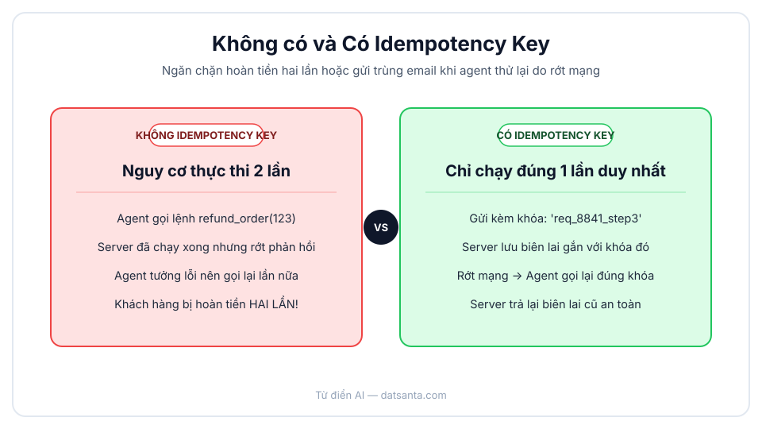

# Idempotency (Tính bất biến khi gọi lại công cụ)

**Idempotency** đảm bảo rằng nếu AI agent gọi lại một công cụ—như trừ tiền thẻ, gửi email hay tạo phiếu hỗ trợ—nhiều lần do rớt mạng, tác vụ thực tế chỉ xảy ra đúng **một lần duy nhất**.

## Ví dụ thực tế

Bấm nút `"Gọi thang máy"` năm lần liên tiếp không làm năm chiếc thang máy cùng chạy tới; nút bấm đó có tính idempotent. Trong hệ thống agent, nếu lệnh `refund_order(order_id=123)` đã chạy thành công trên server nhưng gói tin phản hồi bị rớt mạng, agent sẽ tự động thử lại. Gửi kèm một `idempotency_key` giúp backend nhận ra lượt gọi trùng và trả lại biên lai cũ thay vì hoàn tiền hai lần.

## Đừng nhầm với

- **[Checkpointing](checkpointing.md):** Checkpointing lưu lại vị trí bước đang chạy trong đồ thị của agent; idempotency đảm bảo các API bên ngoài vẫn an toàn nếu một bước bị thực thi lại.

## Thuật ngữ liên quan

- [Function Calling](function-calling.md)
- [Checkpointing](checkpointing.md)
- [Circuit Breaker](circuit-breaker.md)
