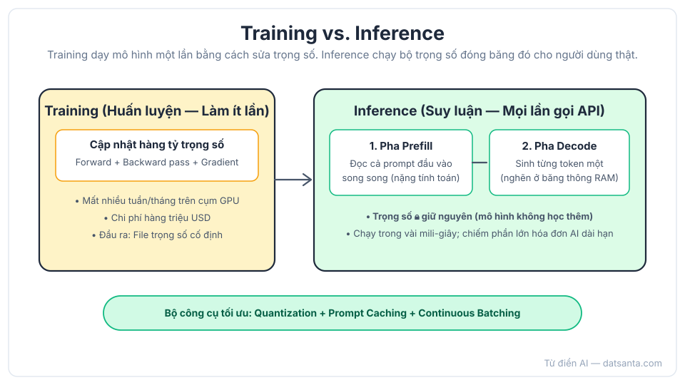

# Inference (Suy luận)

**Inference** là quá trình chạy một mô hình AI đã huấn luyện xong trên môi trường thực tế để sinh câu trả lời cho đầu vào mới, trong khi toàn bộ trọng số mô hình giữ nguyên trạng thái đóng băng.

## Ví dụ đời thường

Training giống 4 năm học đại học — đắt đỏ, kéo dài và chỉ làm ít lần. Inference giống việc đi làm hằng ngày, vận dụng kiến thức đã học để giải quyết câu hỏi mới.

Trong LLM inference, mỗi request gồm 2 pha: **Prefill** (đọc toàn bộ prompt song song, nặng tính toán GPU) và **Decode** (sinh từng [token](token.md) đầu ra nối tiếp, thường nghẽn ở băng thông bộ nhớ GPU).

## Đừng nhầm với

- **Training / [Fine-tuning](fine-tuning.md):** Training sửa đổi trọng số qua lan truyền ngược; inference chỉ chạy xuôi (forward pass) và không tự học vĩnh viễn từ prompt của bạn.
- **Chi phí một lần:** Training chỉ tốn lúc đầu, còn inference chạy trên mọi API call của người dùng — nên tối ưu inference ([quantization](quantization.md), [prompt caching](prompt-caching.md)) quyết định hóa đơn cloud dài hạn.

## Thuật ngữ liên quan

- [Latency vs. Throughput](latency-vs-throughput.md)
- [Quantization](quantization.md)
- [Prompt Caching](prompt-caching.md)
- [Streaming](streaming.md)
