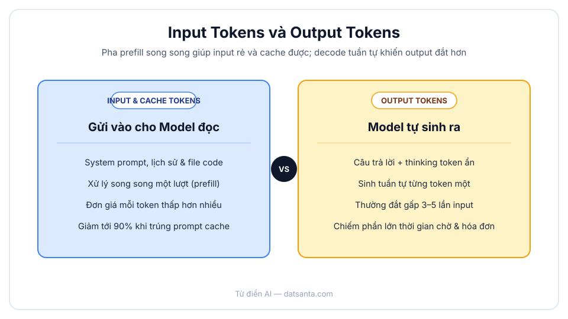

# Input vs. Output Tokens (Token đầu vào & đầu ra)

**Input tokens** là toàn bộ dữ liệu gửi *vào* model (system prompt, lịch sử chat, nội dung file, kết quả tool), còn **output tokens** là toàn bộ chữ model *sinh ra* (câu trả lời hiển thị cộng thêm thinking token ẩn)—và output token thường đắt gấp 3–5 lần.

## Ví dụ thực tế

Đọc một bản hợp đồng 10 trang (input tokens) diễn ra song song một lượt ở pha [prefill](prefill-and-decode.md) nên rất nhanh và rẻ—thậm chí phần tiền tố lặp lại còn được giảm tới 90% nhờ [prompt caching](prompt-caching.md) (cache tokens). Viết ra bản phản hồi 10 trang (output tokens) lại phải chạy tuần tự từng chữ một ở pha decode, ngốn băng thông GPU và chiếm phần lớn hóa đơn API của bạn.

## Đừng nhầm với

- **[Context Window](context-window.md):** Context window là tổng sức chứa cho cả input + output trong một lượt gọi; input vs. output tokens quyết định *đơn giá tính tiền* và *đặc tính độ trễ*.

## Thuật ngữ liên quan

- [Token](token.md)
- [Prompt Caching](prompt-caching.md)
- [Prefill and Decode](prefill-and-decode.md)
