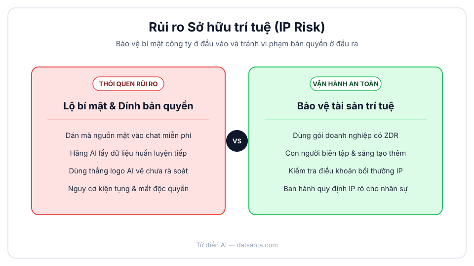

# IP Risk (Rủi ro Sở hữu trí tuệ)

**IP risk** là nguy cơ pháp lý và kinh doanh khi vô tình làm lộ bí mật công nghệ cho nhà cung cấp AI, hoặc xuất bản nội dung do AI tạo ra bị trùng bản quyền người khác—hay không thể đăng ký bản quyền riêng.

## Ví dụ thực tế

Hãy tưởng tượng một nhà thiết kế dùng công cụ tạo ảnh miễn phí để vẽ logo nước giải khát mới, và AI tạo ra hình gần giống hệt thương hiệu nổi tiếng. Hoặc một lập trình viên dán mã nguồn độc quyền của công ty vào chatbot công cộng có lưu dữ liệu để huấn luyện tiếp. Cả hai đều gây ra IP risk: công ty vừa có nguy cơ bị kiện bản quyền, vừa có thể mất quyền độc quyền tài sản trí tuệ của mình.

## Đừng nhầm với

- **[PII](pii.md):** Rủi ro PII liên quan đến lộ thông tin cá nhân của từng người; IP risk liên quan đến bảo vệ tài sản sáng tạo, thương hiệu, mã nguồn và bí quyết kinh doanh.

## Thuật ngữ liên quan

- [Zero Data Retention](zero-data-retention.md)
- [Enterprise Agreement](enterprise-agreement.md)
- [Compliance](compliance.md)
