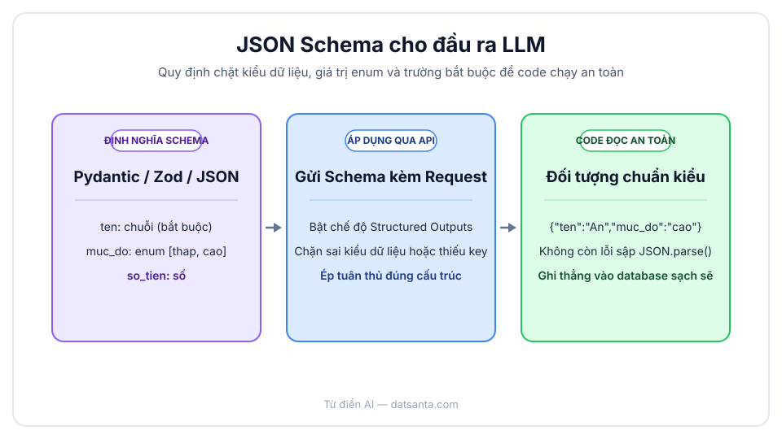

# JSON Schema (Lược đồ cấu trúc JSON)

**JSON Schema** là bản hợp đồng mô tả chính xác tên trường, kiểu dữ liệu, danh sách giá trị hợp lệ (enum) và các trường bắt buộc mà đầu ra có cấu trúc của LLM phải tuân theo để code ứng dụng đọc an toàn.

## Ví dụ thực tế

Hãy hình dung tờ khai hải quan với các ô quy định cứng: `ho_ten` phải là chữ, `so_kien_hanh_ly` phải là số nguyên, còn `muc_dich` chỉ được chọn `["cong_tac", "du_lich"]`. Truyền JSON Schema (thường sinh từ Pydantic hoặc Zod) vào API của LLM sẽ ép câu trả lời khớp đúng khuôn đó—loại bỏ lỗi thiếu key, sai kiểu số thành chuỗi hay phải dùng regex chắp vá.

## Đừng nhầm với

- **[Structured Outputs](structured-outputs.md):** Structured outputs là *tính năng* nhận dữ liệu chuẩn máy đọc từ LLM; JSON Schema là *ngôn ngữ mô tả bản thiết kế* quy định cấu trúc dữ liệu đó.

## Thuật ngữ liên quan

- [Structured Outputs](structured-outputs.md)
- [Grammar-Constrained Decoding](grammar-constrained-decoding.md)
- [Function Calling](function-calling.md)
