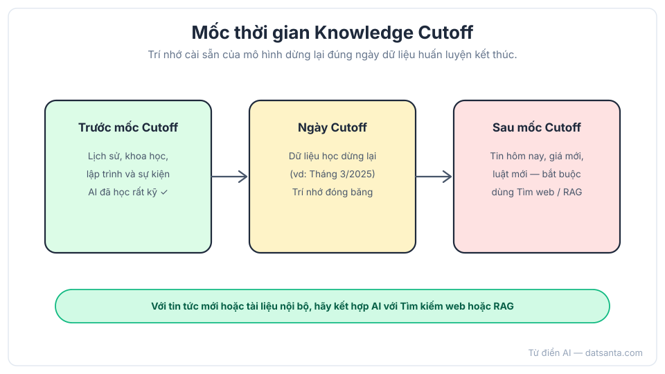

# Knowledge Cutoff (Mốc giới hạn kiến thức)

**Knowledge cutoff** là mốc thời gian cụ thể mà [training data](training-data.md) của mô hình AI dừng lại. Mô hình hoàn toàn không có sẵn ký ức về tin tức, luật mới hay sự kiện xảy ra sau mốc đó trừ khi được nối công cụ tìm kiếm.

## Ví dụ thực tế

Hãy nghĩ tới một bộ bách khoa toàn thư in vào tháng 3 năm 2025. Nó chứa kiến thức nhiều thế kỷ tính đến thời điểm đó, nhưng không thể biết ai thắng trận bóng cuối tuần qua hay tỷ giá ngoại tệ hôm nay.

Nếu bạn hỏi một [LLM](llm.md) ngoại tuyến về sự kiện sau mốc cutoff, nó sẽ báo không biết — hoặc tệ hơn là đoán bừa rồi [hallucinate](hallucination.md). Nối thêm tìm kiếm web hoặc [RAG](rag.md) sẽ khắc phục điểm này.

## Đừng nhầm với

- **[Context window](context-window.md):** Context window là lượng chữ AI đọc được *trong phiên chat hiện tại*; knowledge cutoff là *độ mới* của kiến thức nền AI đã học lúc huấn luyện.
- **Truy cập internet trực tiếp:** Nhiều app chat ngày nay gắn thêm công cụ tìm web phía trên mô hình, giúp tra tin mới dù bản thân mô hình gốc vẫn có mốc cutoff.

## Thuật ngữ liên quan

- [Training Data](training-data.md)
- [Hallucination](hallucination.md)
- [RAG](rag.md)
- [LLM](llm.md)
