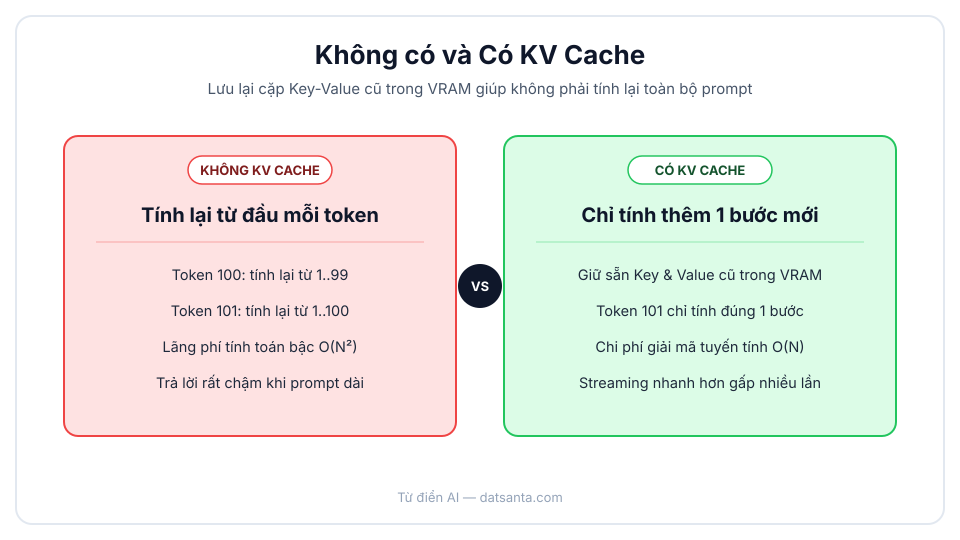

# KV Cache (Bộ nhớ đệm Key-Value)

**KV cache** lưu giữ các cặp key-value trung gian của lớp attention cho những token đã xử lý trong bộ nhớ GPU, giúp model không phải tính lại toàn bộ prompt mỗi khi sinh thêm một token mới.

## Ví dụ thực tế

Khi đọc một cuốn tiểu thuyết 200 trang, bạn ghi chú tóm tắt sau mỗi chương. Đến chương 11, bạn không cần đọc lại từ trang 1 của 10 chương đầu—chỉ cần liếc tờ ghi chú rồi đọc tiếp. Nếu không có KV cache, để sinh ra câu trả lời 500 token, GPU phải tính lại cả prompt 500 lần; nhờ KV cache, mỗi token mới chỉ tính đúng một bước rồi nối thêm vào bộ đệm.

## Đừng nhầm với

- **[Prompt Caching](prompt-caching.md):** KV cache là bộ nhớ tạm cấp thấp trong GPU khi đang sinh một câu trả lời; prompt caching là tính năng cấp API giúp lưu và tái sử dụng trạng thái KV giữa nhiều request khác nhau.

## Thuật ngữ liên quan

- [Prefill and Decode](prefill-and-decode.md)
- [Attention Mechanism](attention-mechanism.md)
- [VRAM](vram.md)
