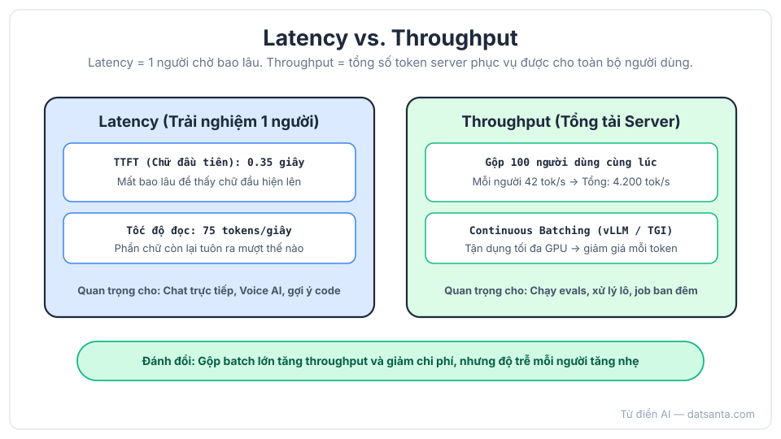

# Latency vs. Throughput

**Latency** đo tốc độ 1 người dùng nhận được phản hồi (`TTFT` và token/giây), còn **throughput** đo tổng số token mỗi giây mà máy chủ xử lý được cho toàn bộ người dùng gộp lại.

## Ví dụ đời thường

Hãy so sánh ca-nô cao tốc và phà lớn. Ca-nô có **latency** cực thấp — chở 1 khách ra đảo mất 3 phút. Phà lớn đi mất 10 phút mỗi chuyến (latency cao hơn), nhưng chở một lượt 500 khách — **throughput** khổng lồ.

Khi phục vụ LLM, kỹ thuật continuous batching (`vLLM`) gom 100 người dùng chạy chung một GPU, đẩy tổng throughput lên 4.200 tok/s để giảm giá mỗi token, đổi lại tốc độ stream của từng người chậm đi đôi chút.

## Đừng nhầm với

- **TTFT (Time To First Token):** Chỉ là thời gian chờ tới khi *token đầu tiên* hiện lên; tổng latency tính tới lúc sinh xong toàn bộ câu trả lời.
- **Ping mạng:** Độ trễ AI API chủ yếu nằm ở thời gian GPU tính prefill/decode ([inference](inference.md)), không chỉ do đường truyền HTTP.

## Thuật ngữ liên quan

- [Streaming](streaming.md)
- [Inference](inference.md)
- [Rate Limiting](rate-limiting.md)
- [Quantization](quantization.md)
