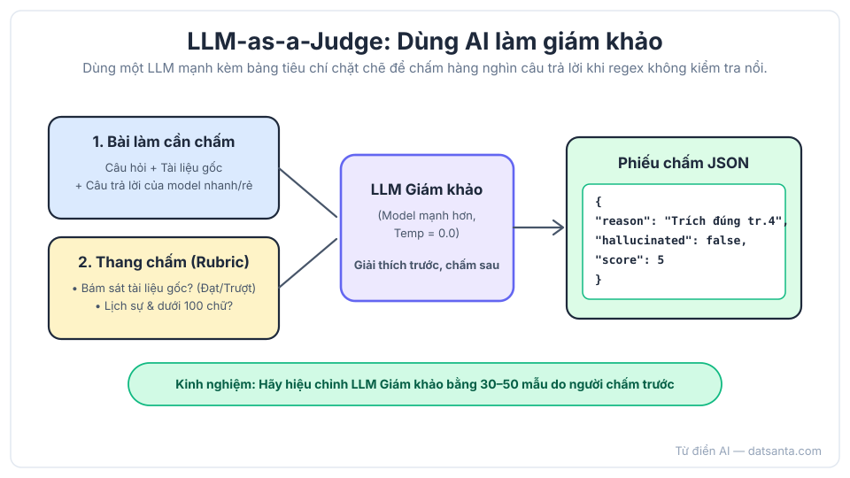

# LLM-as-a-Judge

**LLM-as-a-Judge** dùng một [LLM](llm.md) mạnh kèm thang chấm điểm chặt chẽ để tự động chấm hàng nghìn câu trả lời từ prompt hoặc mô hình rẻ hơn trong bộ [evals](evals.md).

## Ví dụ thực tế

Code kiểm tra được JSON có hợp lệ không, nhưng regex bó tay trước câu hỏi *"Thư trả lời có lịch sự và trích đúng chính sách trang 4 không?"*. Thuê người chấm 2.000 câu sau mỗi pull request thì mất nhiều ngày.

Thay vào đó, bạn đưa `(câu hỏi, tài liệu gốc, câu trả lời)` cùng thang tiêu chí vào LLM Giám khảo ở `temperature = 0`, yêu cầu viết `reason` trước rồi trả về điểm JSON chuẩn.

## Đừng nhầm với

- **Con người chấm (Human eval):** Con người vẫn là chuẩn gốc; bạn nên hiệu chỉnh LLM Giám khảo bằng 30–50 mẫu do người chấm trước để tránh lệch tiêu chí.
- **Tự chấm chính mình:** Bảo *cùng một* model yếu tự hỏi *"Câu trả lời có hay không?"* dễ khiến nó tự khen cả [hallucination](hallucination.md) của mình; giám khảo nên là model mạnh hơn hoặc có tài liệu đối chiếu.

## Thuật ngữ liên quan

- [Evals](evals.md)
- [Structured Outputs](structured-outputs.md)
- [Hallucination](hallucination.md)
- [Temperature](temperature.md)
