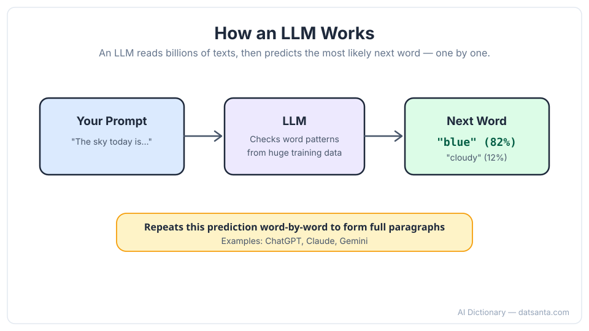

# LLM (Large Language Model)

**LLM** là mô hình AI được huấn luyện trên lượng văn bản khổng lồ để hiểu và viết ngôn ngữ tự nhiên như con người. Về bản chất, nó hoạt động bằng cách đoán từ tiếp theo hợp lý nhất — từng mảnh một — để ghép thành câu trả lời hoàn chỉnh.

## Ví dụ đời thường

Hãy nghĩ đến tính năng gợi ý từ trên bàn phím điện thoại, nhưng phóng đại lên gấp hàng triệu lần. Khi bạn gõ *"Bầu trời hôm nay..."*, điện thoại đoán tiếp *"xanh ngắt"* hoặc *"nhiều mây"*.

Một LLM đã đọc qua hàng tỷ trang sách, bài báo và website. Nhờ nắm được vô số mẫu câu, nó không chỉ đoán một từ mà có thể viết trọn vẹn email, tóm tắt tài liệu, dịch thuật và viết code. ChatGPT, Claude và Gemini đều chạy trên nền tảng LLM.

## Đừng nhầm với

- **Chatbot:** Chatbot là giao diện ứng dụng nơi bạn gõ chữ (như trang web ChatGPT); còn LLM là bộ máy xử lý nằm bên dưới.
- **[AI agent](ai-agent.md):** LLM chỉ trả lời bằng văn bản, còn AI agent có thể tự lập kế hoạch và dùng công cụ bên ngoài như lịch hay trình duyệt.

## Thuật ngữ liên quan

- [Generative AI](generative-ai.md)
- [Token](token.md)
- [Prompt](prompt.md)
- [Context window](context-window.md)
