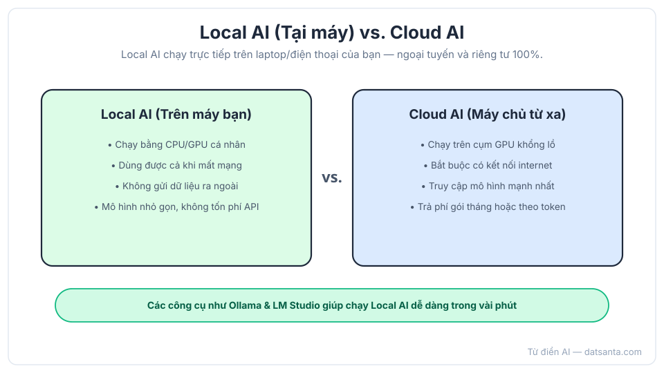

# Local AI (AI chạy tại máy)

**Local AI** là việc chạy mô hình AI trực tiếp trên laptop, máy tính bàn hoặc điện thoại của chính bạn — không cần kết nối internet và không gửi bất kỳ dữ liệu nào ra khỏi thiết bị.

## Ví dụ thực tế

Hãy nghĩ tới việc viết nhật ký cá nhân trong ứng dụng ghi chú trên máy tính thay vì gõ lên một trang web công cộng. Với các công cụ như Ollama hay LM Studio, bạn có thể tải một mô hình gọn đã [quantize](quantization.md) về máy và trò chuyện ngay cả khi đang ngồi trên máy bay tắt Wi-Fi.

Local AI cực mạnh về [data privacy](data-privacy.md) và không tốn phí API hằng tháng, đổi lại các mô hình nhỏ chạy trên máy cá nhân thường kém thông minh hơn các mô hình khổng lồ trên [cloud AI](cloud-ai.md).

## Đừng nhầm với

- **[Cloud AI](cloud-ai.md):** Cloud AI chạy trên trung tâm dữ liệu từ xa và bắt buộc có mạng; local AI chạy ngay trên CPU/GPU máy bạn.
- **App máy tính của ChatGPT/Claude:** Cài ứng dụng ChatGPT lên Windows/Mac vẫn gửi prompt qua mạng về máy chủ đám mây — không phải local AI.

## Thuật ngữ liên quan

- [Cloud AI](cloud-ai.md)
- [Open-Source AI](open-source-ai.md)
- [Quantization](quantization.md)
- [Data Privacy](data-privacy.md)
