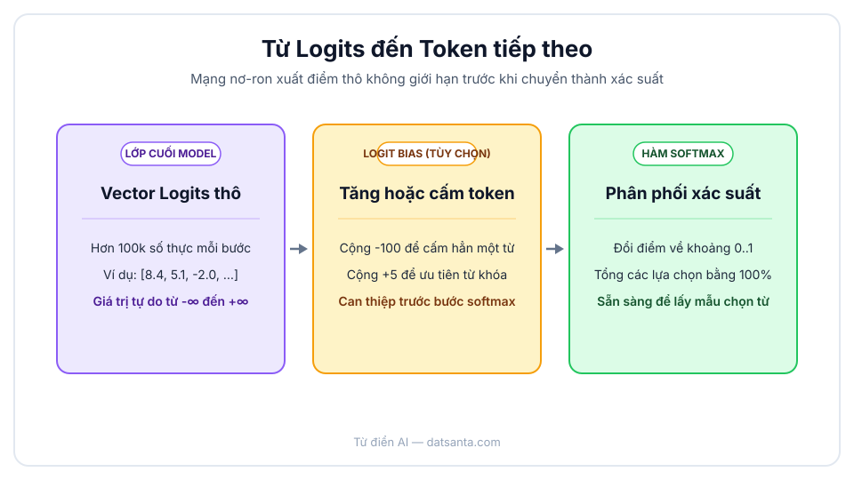

# Logits (Điểm thô đầu ra)

**Logits** là các điểm số thô chưa chuẩn hóa mà mạng nơ-ron tính ra cho từng token trong bộ từ vựng ngay trước bước chuyển đổi thành xác suất.

## Ví dụ thực tế

Trong một cuộc thi hát, ba giám khảo ghi điểm thô ra giấy nháp—ví dụ `8.4` cho Ca sĩ A, `5.1` cho Ca sĩ B và `-2.0` cho Ca sĩ C. Những con số thô đó chính là logits: số càng lớn nghĩa là model càng ưu tiên, số âm hoàn toàn hợp lệ, nhưng chúng chưa phải là phần trăm. Hàm [softmax](softmax.md) sẽ biến dãy logits đó thành xác suất cộng lại bằng `100%`. Lập trình viên cũng hay chỉnh trực tiếp logits (logit bias) để cấm hoặc ưu tiên một số từ nhất định.

## Đừng nhầm với

- **[Softmax](softmax.md):** Logits là điểm thô không giới hạn đi ra từ lớp cuối của model; softmax là hàm toán học biến logits thành xác suất từ 0 đến 1.

## Thuật ngữ liên quan

- [Softmax](softmax.md)
- [Temperature](temperature.md)
- [Top-k Sampling](top-k-sampling.md)
