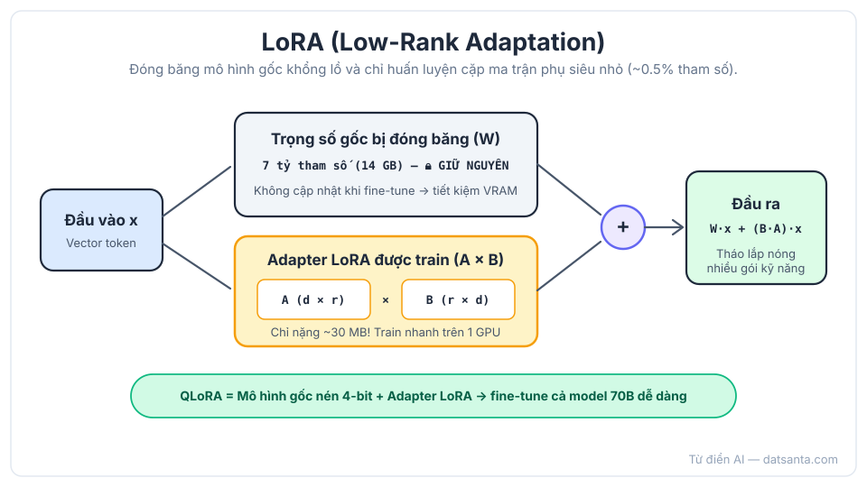

# LoRA (Low-Rank Adaptation)

**LoRA** là phương pháp [fine-tuning](fine-tuning.md) tiết kiệm tham số: đóng băng toàn bộ trọng số mô hình gốc khổng lồ và chỉ huấn luyện thêm cặp ma trận phụ siêu nhỏ đi kèm, giảm cực mạnh lượng VRAM cần thiết.

## Ví dụ đời thường

Thay vì tháo tung cả động cơ 7 tỷ tham số để lắp thêm kỹ năng mới (đòi hỏi cụm GPU đắt đỏ), LoRA gắn thêm hai ma trận gọn nhẹ (`A × B`) chỉ chiếm khoảng ~0.5% tổng số tham số.

File adapter tạo ra thường chỉ nặng ~30 MB thay vì 14 GB. Nhờ vậy bạn có thể tháo lắp nóng nhiều gói kỹ năng LoRA khác nhau lên cùng một mô hình gốc tùy theo từng khách hàng.

## Đừng nhầm với

- **Full fine-tuning:** Huấn luyện lại toàn bộ trọng số dễ gây quên kiến thức cũ và tốn kém VRAM; LoRA giữ nguyên vẹn nền tảng gốc.
- **QLoRA:** QLoRA kết hợp mô hình gốc đã [quantize](quantization.md) 4-bit với adapter LoRA, giúp fine-tune cả mô hình cực lớn chỉ trên một GPU phổ thông.

## Thuật ngữ liên quan

- [Fine-tuning](fine-tuning.md)
- [Quantization](quantization.md)
- [RLHF](rlhf.md)
