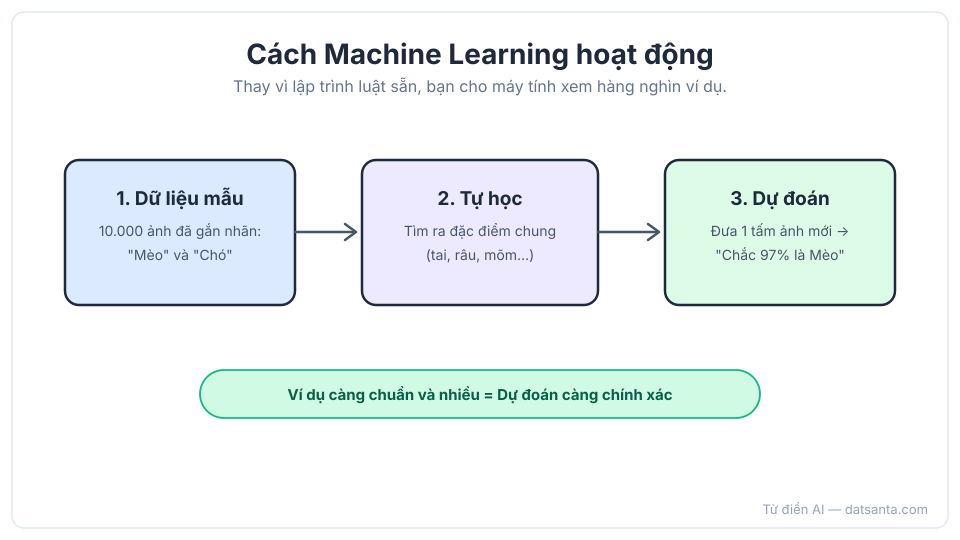

# Machine Learning (Học máy)

**Machine learning** là cách dạy máy tính bằng cách cho nó xem hàng nghìn ví dụ thay vì viết sẵn từng quy tắc. Máy tính sẽ tự tìm ra quy luật ẩn bên trong để dự đoán cho những dữ liệu mới.

## Ví dụ đời thường

Hãy tưởng tượng bạn dạy một em bé phân biệt chó và mèo. Bạn không hề viết sách quy tắc kiểu *"nếu tai nhọn và mũi ngắn thì là mèo"*. Bạn chỉ chỉ vào hàng trăm tấm ảnh và nói *"đây là mèo"*, *"đây là chó"*. Chẳng bao lâu sau, em bé tự nhận ra một chú mèo lạ chưa từng thấy bao giờ.

Machine learning cũng vậy: bạn đưa cho máy 10.000 tấm ảnh đã gắn nhãn, nó sẽ tự học các đặc điểm hình ảnh để phân loại ảnh mới chính xác.

## Đừng nhầm với

- **[AI](ai.md):** Mục tiêu lớn hơn là giúp máy móc hành xử thông minh; machine learning là kỹ thuật cốt lõi dùng để đạt được điều đó.
- **[Generative AI](generative-ai.md):** Nhánh mới của machine learning tập trung vào việc tạo ra văn bản, hình ảnh, âm thanh mới hoàn toàn chứ không chỉ phân loại.

## Thuật ngữ liên quan

- [AI](ai.md)
- [Generative AI](generative-ai.md)
- [Fine-tuning](fine-tuning.md)
