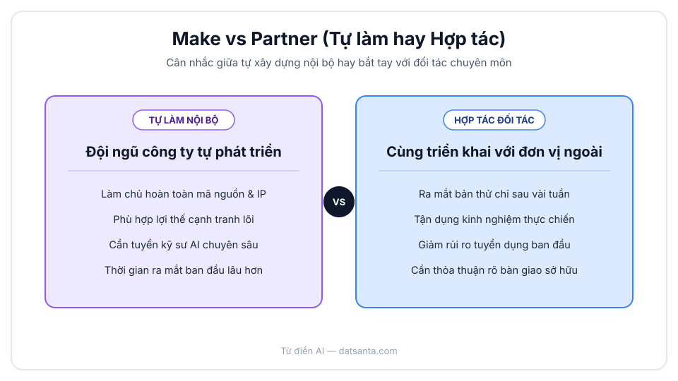

# Make vs Partner (Tự làm hay Hợp tác)

**Make vs partner** là quyết định chiến lược xem doanh nghiệp nên tự xây dựng giải pháp AI bằng đội ngũ nội bộ, hay hợp tác với một đối tác chuyên môn bên ngoài để triển khai nhanh hơn và giảm rủi ro kỹ thuật.

## Ví dụ thực tế

Một chuỗi phòng khám muốn có trợ lý AI đặt lịch và tóm tắt bệnh án. Tự tuyển kỹ sư AI, thuê máy chủ và tự nghiên cứu bảo mật y tế có thể mất cả năm trời. Hợp tác với một công ty công nghệ y tế có sẵn kinh nghiệm giúp phòng khám vận hành bản thử nghiệm chỉ trong 6 tuần, trong khi đội ngũ nội bộ tập trung vào chuyên môn khám chữa bệnh.

## Đừng nhầm với

- **[Build vs Buy](build-vs-buy.md):** Build vs buy là lựa chọn giữa tự lập trình phần mềm hay mua phần mềm đóng gói có sẵn; make vs partner nhấn mạnh việc tự làm hay thuê đối tác cùng triển khai và chuyển giao giải pháp riêng.

## Thuật ngữ liên quan

- [Build vs Buy](build-vs-buy.md)
- [Vendor Lock-in](vendor-lock-in.md)
- [TCO](tco.md)
