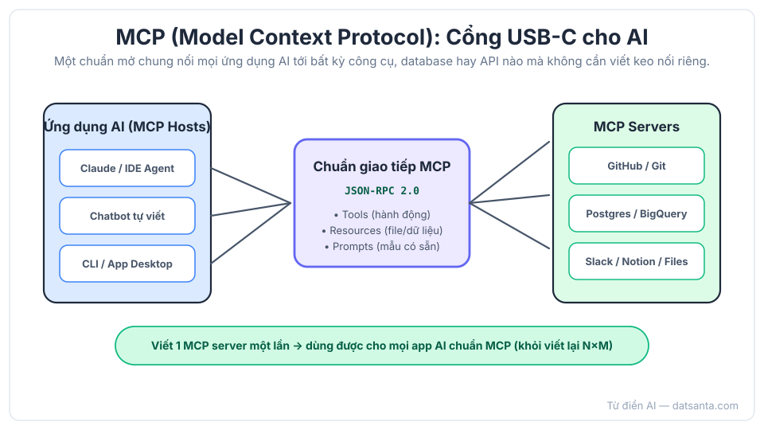

# MCP (Model Context Protocol)

**MCP** là giao thức chuẩn mở (giống cổng USB-C cho ứng dụng AI) quy định một cách kết nối thống nhất để mọi [LLM](llm.md) hoặc [AI agent](ai-agent.md) giao tiếp với công cụ, database và kho file bên ngoài.

## Ví dụ đời thường

Trước khi có USB-C, mỗi hãng điện thoại và laptop đòi một đầu sạc riêng. Trước khi có MCP, muốn nối 5 app AI tới 10 công cụ nội bộ (GitHub, Postgres, Slack, Notion) bạn phải viết 50 đoạn code nối riêng lẻ.

Với MCP, bạn chỉ cần viết một **MCP Server** cho Postgres dùng JSON-RPC, công bố sẵn **Tools**, **Resources** và **Prompts**. Mọi IDE, CLI hay agent hỗ trợ MCP đều cắm vào chạy được ngay.

## Đừng nhầm với

- **[Function calling](function-calling.md):** Function calling là cách LLM yêu cầu gọi một hàm trong 1 API call; MCP là tầng giao thức client–server để khám phá và vận hành công cụ đồng bộ giữa nhiều app.
- **REST API:** REST phục vụ lập trình viên gọi thủ công; MCP cung cấp sẵn mô tả và schema tối ưu để LLM tự đọc hiểu.

## Thuật ngữ liên quan

- [Function Calling](function-calling.md)
- [AI Agent](ai-agent.md)
- [Orchestration](orchestration.md)
- [Sandbox](sandbox.md)
