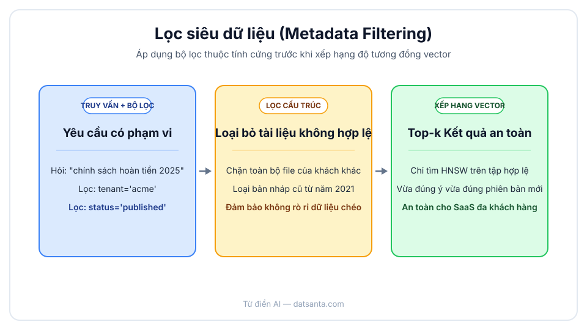

# Metadata Filtering (Lọc theo siêu dữ liệu)

**Metadata filtering** thu hẹp phạm vi tìm kiếm trong vector database dựa trên các trường có cấu trúc—như `tenant_id`, `năm`, `phòng_ban` hay `loại_tài_liệu`—trước hoặc trong khi so khớp độ tương đồng.

## Ví dụ thực tế

Tìm kiếm cụm `"chính sách hoàn tiền"` trên toàn bộ ổ đĩa công ty có thể kéo nhầm bản nháp hết hạn từ năm 2021 hoặc hợp đồng riêng của khách hàng khác. Với metadata filtering (`company = "acme" AND year >= 2025 AND status = "published"`), bộ máy tìm kiếm chỉ quét đúng tài liệu hợp lệ. Đây là lớp bảo vệ bắt buộc cho ứng dụng SaaS đa khách hàng để [RAG](rag.md) không bao giờ rò rỉ tài liệu chéo nhau.

## Đừng nhầm với

- **[Reranking](reranking.md):** Reranking sắp xếp lại thứ hạng các đoạn văn bản dựa trên nội dung đọc hiểu sâu; metadata filtering loại trừ hoặc giữ lại tài liệu tuyệt đối theo thuộc tính cấu trúc.

## Thuật ngữ liên quan

- [Vector Database](vector-database.md)
- [HNSW](hnsw.md)
- [RAG](rag.md)
