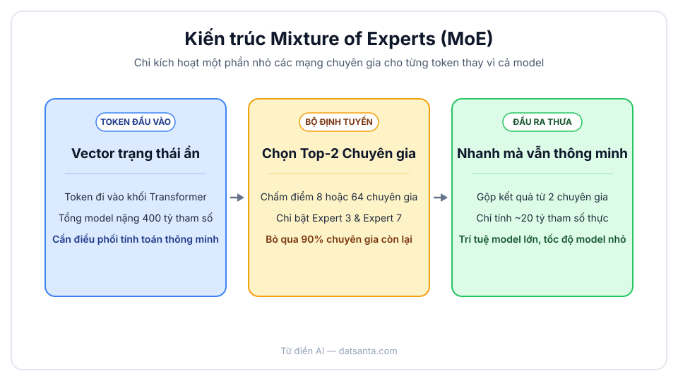

# Mixture of Experts (MoE — Hỗn hợp Chuyên gia)

**Mixture of Experts (MoE)** là kiến trúc chia một mạng nơ-ron khổng lồ thành nhiều mạng con chuyên biệt ("chuyên gia") và dùng bộ định tuyến nhẹ để chỉ kích hoạt vài chuyên gia phù hợp cho mỗi token.

## Ví dụ thực tế

Một bệnh viện lớn có 64 bác sĩ chuyên khoa, nhưng khi bạn vào khám vì trật cổ chân, chỉ có điều dưỡng phân loại và 2 bác sĩ chỉnh hình trực tiếp khám cho bạn—không phải cả 64 bác sĩ cùng họp một lúc. Tương tự, một model MoE có thể chứa 400 tỷ tham số trong bộ nhớ nhưng chỉ kích hoạt 20 tỷ tham số cho mỗi token, giúp đạt trí tuệ của model lớn với tốc độ gần bằng model nhỏ.

## Đừng nhầm với

- **[Multi-Agent System](multi-agent-system.md):** Multi-agent phối hợp nhiều lượt gọi LLM riêng lẻ ở tầng ứng dụng; MoE định tuyến token nội bộ giữa các lớp mạng ngay bên trong một model duy nhất.

## Thuật ngữ liên quan

- [Transformer](transformer.md)
- [Inference](inference.md)
- [VRAM](vram.md)
