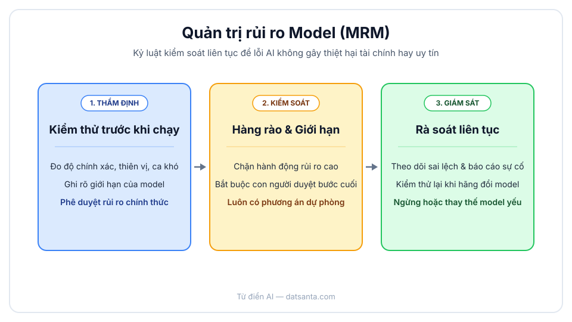

# Model Risk Management (Quản trị rủi ro Model)

**Model risk management (MRM)** là quy trình kiểm thử, phê duyệt và theo dõi liên tục các model AI để sai sót, thiên vị hoặc biến động bất thường không gây thiệt hại tài chính, pháp lý hay uy tín cho doanh nghiệp.

## Ví dụ thực tế

Hãng hàng không không bao giờ kiểm tra máy bay một lần lúc mới mua rồi bỏ mặc. Họ luôn có bảng kiểm trước mỗi chuyến bay, theo dõi mọi đèn báo lỗi và cho tàu bay dừng hoạt động ngay nếu động cơ có dấu hiệu lạ. Với AI doanh nghiệp cũng vậy: trước khi AI tự động duyệt hoàn tiền hay sàng lọc hồ sơ ứng viên, đội ngũ rủi ro phải kiểm tra các tình huống dễ sai và giám sát liên tục sau khi chạy thật.

## Đừng nhầm với

- **[AI Pilot](ai-pilot.md):** Pilot là giai đoạn thử nghiệm xem công cụ có tạo ra giá trị kinh doanh không; model risk management là kỷ luật phòng ngừa rủi ro vận hành và pháp lý xuyên suốt vòng đời hệ thống.

## Thuật ngữ liên quan

- [Post-Deployment Monitoring](post-deployment-monitoring.md)
- [Audit Trail](audit-trail.md)
- [Compliance](compliance.md)
