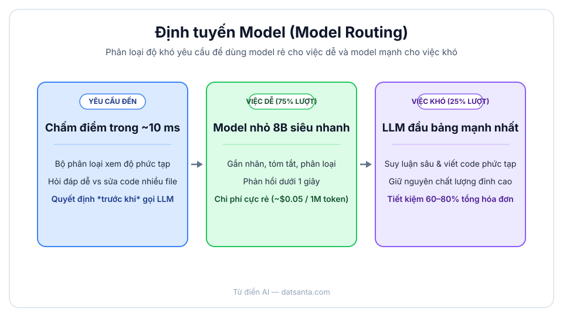

# Model Routing (Định tuyến Model)

**Model routing** tự động đánh giá độ phức tạp, độ dài hoặc mức độ nhạy cảm của từng yêu cầu đến để đẩy việc đơn giản sang model nhỏ vừa nhanh vừa rẻ, còn việc suy luận khó mới dùng model đầu bảng đắt tiền.

## Ví dụ thực tế

Tổng đài chăm sóc khách hàng không bao giờ chuyển câu hỏi `"Mã vận đơn của tôi đâu?"` lên cho giám đốc pháp chế xử lý. Một bộ phân loại nhẹ kiểm tra yêu cầu trong 10 ms: việc phân loại ý định hay tóm tắt ngắn đi thẳng vào model 8B giá siêu rẻ, trong khi gỡ lỗi code nhiều file hay rà soát hợp đồng chuyển sang model mạnh nhất—giảm 60–80% chi phí suy luận mà không giảm chất lượng.

## Đừng nhầm với

- **[Fallback Chain](fallback-chain.md):** Fallback chain chỉ đổi model khi nhà cung cấp chính *bị lỗi hoặc quá tải*; model routing chủ động chọn model tối ưu giá/hiệu năng *ngay từ trước khi gọi*.

## Thuật ngữ liên quan

- [Service Tiering](service-tiering.md)
- [AI Gateway](ai-gateway.md)
- [Cost per Task](cost-per-task.md)
