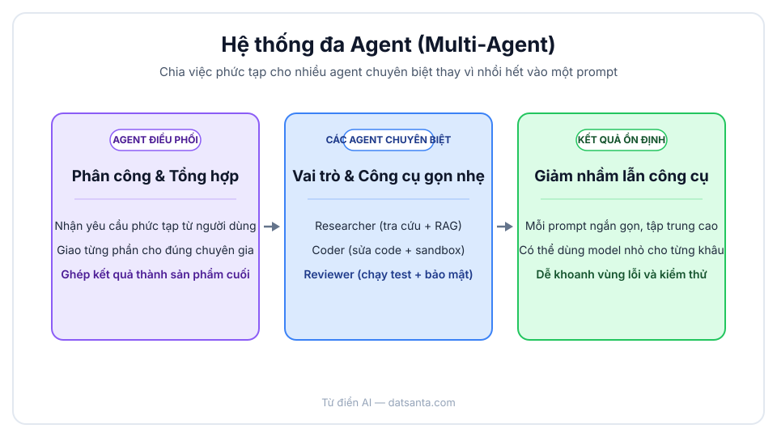

# Multi-Agent System (Hệ thống đa Agent)

**Multi-agent system** chia nhỏ một quy trình phức tạp cho nhiều AI agent chuyên biệt—mỗi agent có system prompt, model và bộ công cụ riêng gọn nhẹ—phối hợp với nhau qua bộ điều phối hoặc trạng thái dùng chung.

## Ví dụ thực tế

Một sản phẩm phần mềm hiếm khi do một người tự làm hết từ thiết kế, backend, kiểm thử bảo mật đến viết tài liệu—và việc nhồi 40 công cụ vào chung một prompt cũng làm LLM dễ bị rối. Thay vào đó, một agent điều phối sẽ giao việc tìm tài liệu cho Researcher agent, sửa code cho Coder agent và kiểm tra chéo cho Reviewer agent, giúp từng bước sắc bén và ổn định hơn.

## Đừng nhầm với

- **[Mixture of Experts (MoE)](mixture-of-experts.md):** MoE là lớp mạng nơ-ron nội bộ nằm bên trong *một model duy nhất*; multi-agent system điều phối *nhiều lượt gọi LLM tách biệt* ở tầng ứng dụng.

## Thuật ngữ liên quan

- [Orchestration](orchestration.md)
- [Handoff](handoff.md)
- [A2A Protocol](a2a-protocol.md)
