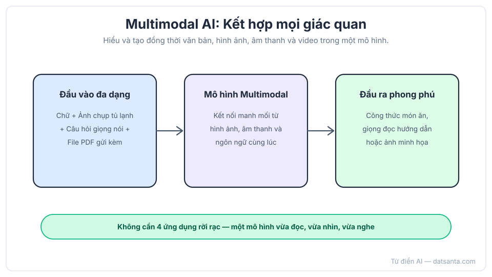

# Multimodal AI (AI đa phương thức)

**Multimodal AI** là mô hình AI có thể hiểu và tạo ra nhiều dạng dữ liệu khác nhau — kết hợp văn bản, hình ảnh, âm thanh, video và tài liệu ngay trong cùng một cuộc trò chuyện.

## Ví dụ thực tế

Các công cụ AI đời trước chỉ có một "giác quan": công cụ này chỉ đọc chữ, công cụ kia chỉ nhận diện ảnh, công cụ khác chỉ chép giọng nói.

Với multimodal AI, bạn có thể chụp ảnh chiếc tủ lạnh, hỏi bằng giọng nói *"Tối nay nấu món gì nhanh gọn với mấy nguyên liệu này?"*, và nghe AI đọc lại công thức. Nó kết nối thứ mình nhìn, nghe và đọc giống như con người.

## Đừng nhầm với

- **[LLM](llm.md) thuần văn bản:** LLM đời đầu chỉ xử lý chữ viết; các mô hình lớn ngày nay đều là multimodal, nhận được cả ảnh chụp màn hình, PDF, giọng nói và video.
- **[Text-to-image](text-to-image.md):** Text-to-image chỉ biến chữ thành tranh; multimodal AI xử lý linh hoạt nhiều kiểu đầu vào và đầu ra cùng lúc.

## Thuật ngữ liên quan

- [Foundation Model](foundation-model.md)
- [Computer Vision](computer-vision.md)
- [Text-to-Image](text-to-image.md)
- [Speech-to-Text](speech-to-text.md)
