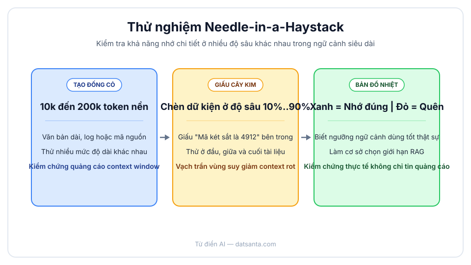

# Needle-in-a-Haystack Test (Thử nghiệm Tìm kim đáy bể)

**Needle-in-a-Haystack (NIAH)** là bài kiểm tra đánh giá model ngữ cảnh dài bằng cách giấu một dữ kiện ngẫu nhiên ("cây kim") tại nhiều vị trí độ sâu khác nhau bên trong một khối văn bản nhiễu khổng lồ ("đống cỏ") để xem model có tìm lại chính xác không.

## Ví dụ thực tế

Nếu hãng xe quảng cáo xe tải chở được 10 tấn, bạn phải chất hàng thật lên chạy thử chứ không chỉ tin tờ rơi. Tương tự, khi LLM công bố [context window](context-window.md) rộng `200.000` token, kỹ sư giấu câu `"Mã két sắt là 4912"` ở mốc 10%, 50% và 90% bên trong 150.000 token văn bản để đo xem từ độ dài nào hiện tượng [context rot](context-rot.md) bắt đầu làm model nhớ sót.

## Đừng nhầm với

- **[Benchmark](benchmark.md):** Benchmark tổng quát đo trí thông minh viết code, làm toán trên prompt ngắn; NIAH kiểm tra riêng khả năng ghi nhớ chi tiết xuyên suốt các độ dài và vị trí ngữ cảnh cực lớn.

## Thuật ngữ liên quan

- [Context Rot](context-rot.md)
- [Context Window](context-window.md)
- [Evals (Evaluations)](evals.md)
