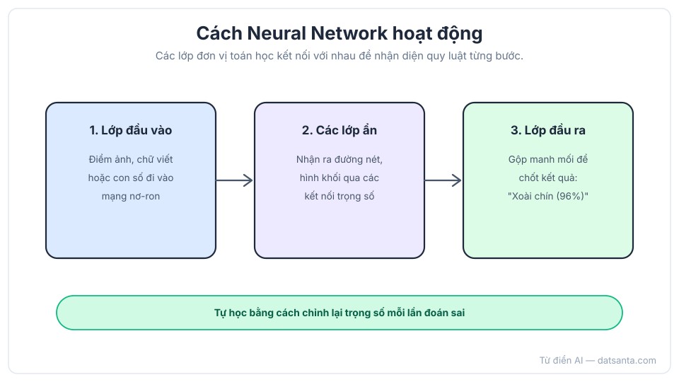

# Neural Network (Mạng nơ-ron nhân tạo)

**Neural network** là hệ thống máy tính lấy cảm hứng nhẹ từ bộ não người, gồm nhiều lớp đơn vị toán học kết nối với nhau để cùng phát hiện quy luật trong dữ liệu.

## Ví dụ thực tế

Hãy tưởng tượng một dây chuyền phân loại trái cây. Nhóm đầu tiên chỉ nhìn màu sắc, nhóm thứ hai kiểm tra hình dáng và kích cỡ, còn người cuối cùng gộp tất cả manh mối để chốt: *"Đây là quả xoài chín."*

Neural network hoạt động tương tự. Dữ liệu thô đi vào lớp đầu, các lớp giữa nhận diện đường nét và hình khối, lớp cuối đưa ra kết quả — tự điều chỉnh độ mạnh yếu của từng kết nối mỗi khi đoán sai.

## Đừng nhầm với

- **Bộ não người thật:** Neural network không có cảm xúc hay ý thức; bên trong nó thuần túy là các phép nhân và cộng trọng số xếp tầng.
- **[Deep learning](deep-learning.md):** Deep learning đơn giản là neural network có *rất nhiều* lớp ẩn xếp chồng lên nhau thay vì chỉ một hai lớp.

## Thuật ngữ liên quan

- [Deep Learning](deep-learning.md)
- [Machine Learning](machine-learning.md)
- [Parameters](parameters.md)
- [Training Data](training-data.md)
