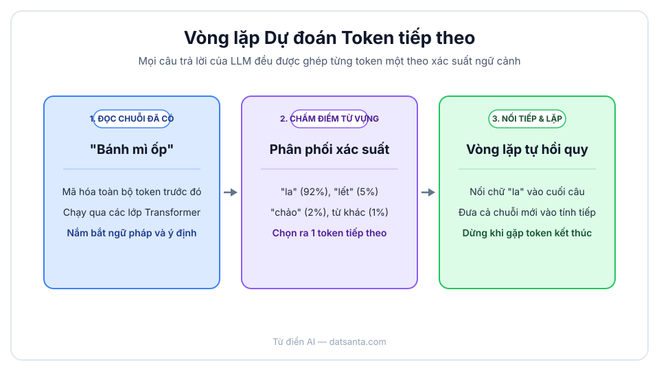

# Next-Token Prediction (Dự đoán Token tiếp theo)

**Next-token prediction** là mục tiêu huấn luyện và cơ chế vận hành cốt lõi của mọi LLM hiện đại: dựa trên toàn bộ chuỗi token đã thấy, tính phân phối xác suất trên bộ từ vựng rồi chọn token tiếp theo hợp lý nhất—lặp lại cho tới khi kết thúc.

## Ví dụ thực tế

Khi bạn bè vừa nói `"Bánh mì ốp ..."`, não bạn lập tức đoán ra chữ `"la"` với độ chắc chắn cực cao trước khi họ kịp dứt lời. Nhân rộng trò chơi đơn giản đó trên hàng nghìn tỷ từ mã nguồn, sách vở và toán học buộc mạng nơ-ron phải tự học ngữ pháp, logic và tư duy lập trình chỉ để đoán trúng token kế tiếp. Cơ chế này cũng giải thích vì sao model không thể "rút lại" một từ sai đã lỡ xuất ra mà phải viết tiếp để sửa.

## Đừng nhầm với

- **[Reasoning Model](reasoning-model.md):** Mô hình suy luận bên dưới vẫn chạy bằng next-token prediction—chúng chỉ dành thêm nhiều token suy nghĩ ẩn để tự phân tích từng bước trước khi xuất câu trả lời cuối.

## Thuật ngữ liên quan

- [Token](token.md)
- [Logits](logits.md)
- [LLM](llm.md)
