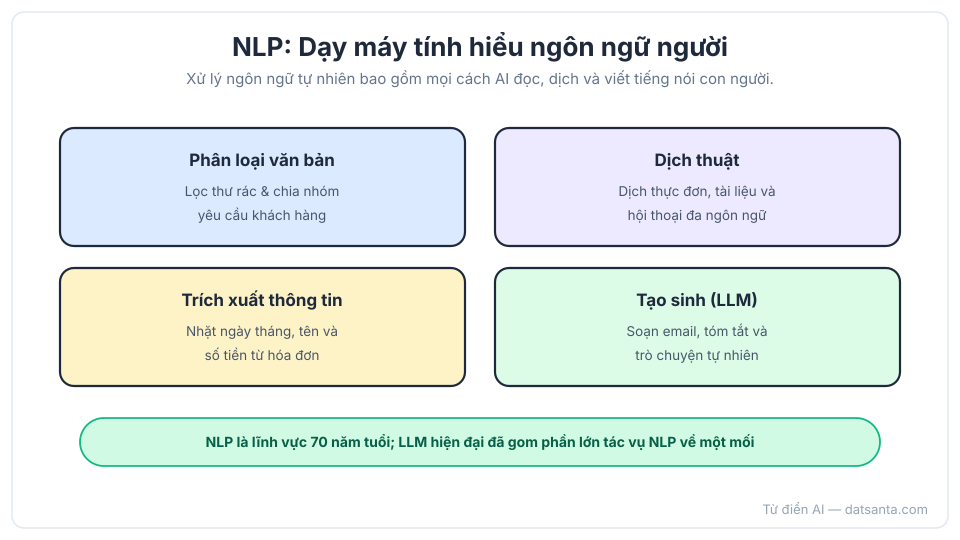

# NLP (Xử lý ngôn ngữ tự nhiên)

**NLP** (Natural Language Processing) là nhánh AI giúp máy tính đọc, hiểu, dịch và viết ngôn ngữ giao tiếp hằng ngày của con người — thay vì đòi hỏi các dòng code cứng nhắc.

## Ví dụ thực tế

Mỗi khi Gmail tự chặn thư rác, Google Dịch chuyển thực đơn tiếng Thái sang tiếng Việt, hay bàn phím điện thoại gợi ý từ tiếp theo lúc bạn nhắn tin, bạn đều đang dùng NLP.

Nhiều thập kỷ trước, NLP gồm hàng loạt công cụ nhỏ tách rời cho ngữ pháp, dịch thuật hay phân tích cảm xúc. Ngày nay, các [LLM](llm.md) chạy trên kiến trúc [Transformer](transformer.md) xử lý hầu hết tác vụ NLP cổ điển trong cùng một mô hình.

## Đừng nhầm với

- **[LLM](llm.md):** NLP là cả lĩnh vực AI ngôn ngữ có tuổi đời 70 năm; LLM là công nghệ đột phá hiện đại nằm bên trong lĩnh vực đó.
- **Ngôn ngữ lập trình:** Python hay JavaScript là ngôn ngữ hình thức viết cho máy; "ngôn ngữ tự nhiên" là tiếng nói đời thường như tiếng Việt hay tiếng Anh.

## Thuật ngữ liên quan

- [LLM](llm.md)
- [Transformer](transformer.md)
- [Speech-to-Text](speech-to-text.md)
- [Generative AI](generative-ai.md)
