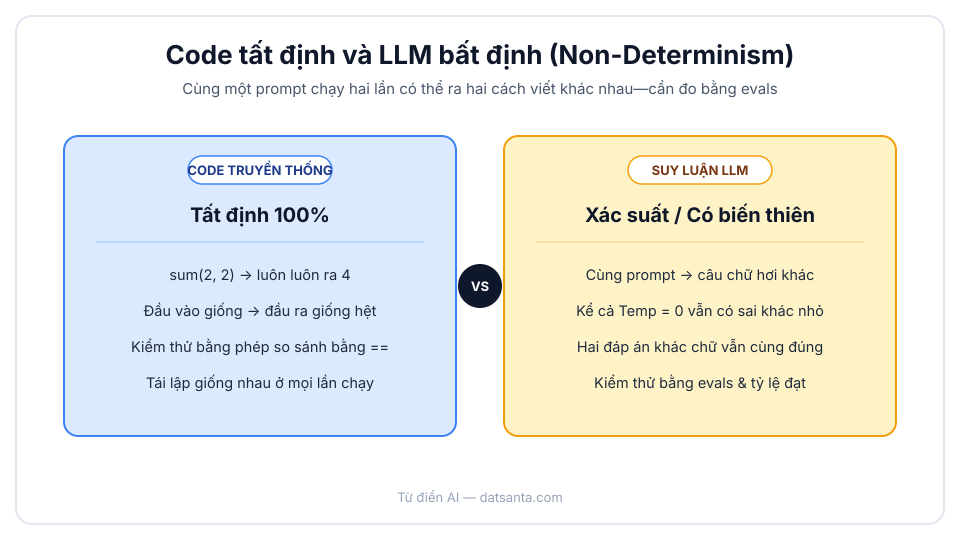

# Non-Determinism (Tính bất định)

**Non-determinism** nghĩa là gửi cùng một prompt giống hệt nhau cho LLM hai lần vẫn có thể nhận về hai cách diễn đạt, hai đoạn code hoặc hai chuỗi gọi công cụ khác nhau—khác hẳn phần mềm truyền thống vốn luôn cho một kết quả duy nhất.

## Ví dụ thực tế

Chiếc máy tính bỏ túi có tính tất định tuyệt đối: `2 + 2` luôn bằng `4` suốt trăm năm. Nhờ một người viết nội dung `"tóm tắt báo cáo này trong hai câu"` vào thứ Hai và thứ Ba sẽ cho ra hai bản tóm tắt đều đúng nhưng dùng từ khác nhau. Ngay cả khi chỉnh [temperature](temperature.md) về `0`, phép tính dấu phẩy động song song trên GPU vẫn gây sai lệch nhẹ, nên ứng dụng AI phải đánh giá bằng [evals](evals.md) và tỷ lệ đạt thay vì so sánh bằng chuỗi cứng.

## Đừng nhầm với

- **[Hallucination](hallucination.md):** Non-determinism là sự biến thiên tự nhiên giữa các lần chạy (kể cả khi cả hai kết quả đều đúng); hallucination là câu trả lời bịa đặt sai sự thật.

## Thuật ngữ liên quan

- [Temperature](temperature.md)
- [Evals (Evaluations)](evals.md)
- [Golden Dataset](golden-dataset.md)
